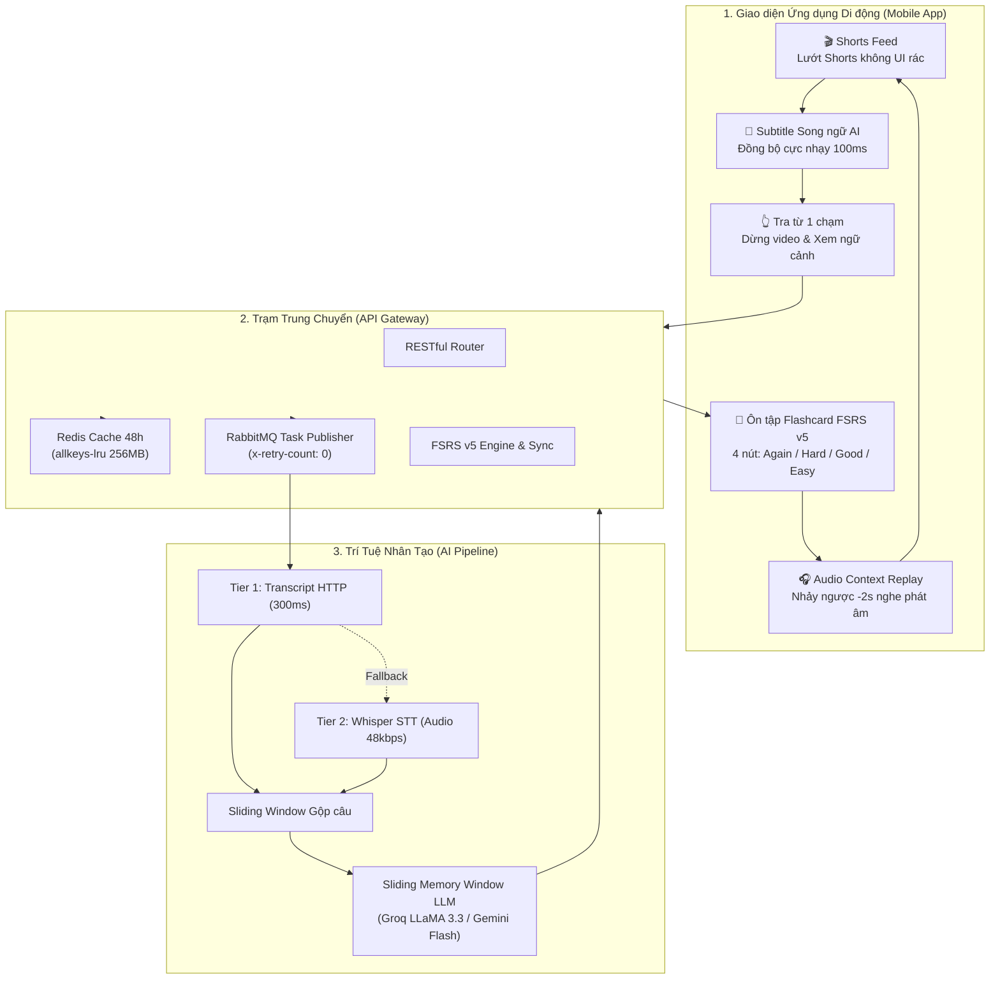

# 📱 ShortLearn — Đặc Tả Danh Mục Chức Năng Ứng Dụng (Feature Specification)

> **ShortLearn** là giải pháp EdTech Micro-learning đột phá: Biến thói quen lướt video ngắn (YouTube Shorts) hàng ngày thành hành trình học tiếng Anh phản xạ tự nhiên. Ứng dụng kết hợp giữa **Phụ đề Song ngữ AI thời gian thực**, **Tra từ ngữ cảnh 1 chạm** và **Hệ thống Lặp lại ngắt quãng thế hệ mới FSRS v5**.

---

## 🧭 Kiến Trúc Tổng Thể & Luồng Tính Năng



---

## 🌟 PHẦN 1: TÍNH NĂNG DÀNH CHO NGƯỜI DÙNG (USER FEATURES)

### 1. 🎬 Lướt YouTube Shorts Không Quảng Cáo & Giao Diện Sạch
- **Loại bỏ 100% UI rác**: Ẩn thanh header, nút Open App, bottom bar, thanh đề xuất, avatar che mắt của YouTube web mobile.
- **Tối ưu tập trung học tập**: Toàn màn hình chỉ dành riêng cho video và phụ đề song ngữ.
- **Hỗ trợ SPA mượt mà**: Chặn reload trang, bắt sự kiện chuyển video Shorts ngay tức thì ($0\text{ms}$) qua hook `history.pushState` & `replaceState`.

### 2. 💬 Phụ Đề Song Ngữ AI Thời Gian Thực (Bilingual Overlay)
- **Đồng bộ siêu tốc 100ms**: Tần số nhận diện thời gian phát được hạ từ 250ms xuống 100ms, giúp phụ đề xuất hiện chuẩn xác theo từng câu hát, lời thoại rap hay hội thoại tốc độ cao.
- **Thiết kế Glassmorphism chống chói**: Nền tối bán trong suốt (Slate Dark), chữ tiếng Anh viền đổ bóng (text-shadow) đậm nét, dòng tiếng Việt màu hổ phách dễ đọc trên mọi nền sáng/tối.
- **Khử phụ đề gốc YouTube**: 3 tầng CSS bảo vệ tự động ẩn phụ đề gốc của YouTube, tránh hiện tượng chữ đè chữ gây rối mắt.

### 3. 👆 Chạm Vào Từng Từ Để Tra Cứu Tức Thì (Interactive Word Tapping)
- **Tách từ tương tác**: Mỗi từ trong câu tiếng Anh được bóc tách thành nút bấm riêng biệt.
- **Tự động Pause thông minh**: Khi người dùng chạm vào một từ chưa hiểu, ứng dụng gửi tín hiệu dừng video ngay lập tức để người học không bị trôi nội dung.
- **Cửa sổ tra cứu ngữ cảnh**:
  - Hiển thị từ vựng dạng viết hoa rõ nét kèm phiên âm IPA.
  - Trích xuất toàn bộ câu gốc trong video để người học nắm rõ ngữ cảnh sử dụng thực tế.

### 4. ⭐ Lưu Nhanh Từ Vựng Vào Flashcard (1-Tap SRS Saving)
- Bấm **"⭐ Lưu vào Flashcard FSRS"** ngay trong popup để đưa từ vựng vào hàng đợi ghi nhớ dài hạn.
- Hệ thống tự động ghi nhận:
  - Từ vựng gốc & định nghĩa ngữ cảnh.
  - Câu hội thoại mẫu trong video.
  - Video ID & mốc thời gian phát âm chính xác (`timestamp_mark`).
  - Khởi tạo trạng thái FSRS: Độ khó $D=5.0$, Độ ổn định $S=0$, Trạng thái `new`.

### 5. 🧠 Màn Hình Ôn Tập Flashcard FSRS v5 (Hiện Đại Nhất Thế Giới)
- **Thay thế hoàn toàn thuật toán SM-2 cũ**: Ứng dụng triển khai mô hình **DSR (Difficulty, Stability, Retrievability)** của FSRS v5 (Free Spaced Repetition Scheduler) được huấn luyện trên 300 triệu lượt ôn tập thực tế:
  - **Giảm 20% đến 30%** số lượt ôn tập thừa thãi so với SM-2.
  - **Loại bỏ triệt để lỗi "Ease Hell"** (tình trạng kẹt trong chu kỳ ôn liên tục do Ease Factor giảm quá sâu).
- **Lật thẻ 2 mặt mượt mà**: Mặt trước hiển thị từ vựng & câu ví dụ; chạm vào thẻ để mở ra định nghĩa và phần chấm điểm.

### 6. 🎧 Tính Năng "Audio Context Replay" (Nghe Lại Phát Âm Bản Xứ -2s)
- Điểm khác biệt lớn nhất so với các ứng dụng học từ vựng thông thường:
  - Mỗi thẻ Flashcard có nút **"🎧 Nghe lại giọng bản xứ (-2s)"**.
  - Khi bấm, ứng dụng tự động mở lại đúng video Shorts tại mốc trước thời điểm phát âm 2 giây.
  - Giúp người học nghe lại ngữ điệu, cách nối âm, nuốt âm thực tế của người bản xứ trong video gốc.

### 7. 🎯 4 Cấp Độ Đánh Giá Kèm Dự Đoán Khoảng Thời Gian Ôn Tập
Mỗi nút đánh giá hiển thị trực tiếp thời gian thẻ sẽ xuất hiện lại trong tương lai:
1. 🔴 **Quên (Again)**: `< 1 ngày` — Đặt lại chu kỳ học, đưa thẻ vào trạng thái `relearning`.
2. 🟠 **Khó (Hard)**: `~1 - 2 ngày` — Tăng độ khó, điều chỉnh khoảng cách ngắn hơn bình thường.
3. 🟢 **Nhớ (Good)**: `~3 - 5 ngày` — Tăng độ bền trí nhớ theo cấp số tối ưu.
4. 🔵 **Dễ (Easy)**: `~7 - 14 ngày` — Thưởng thêm chu kỳ, giảm độ khó cho từ vựng đã ghi nhớ sâu.

### 8. 📊 Bộ Đếm Thẻ Đến Hạn & Huy Hiệu Nhắc Nhở (Due Badges)
- Thanh điều hướng bên dưới (Bottom Navigation) có huy hiệu đỏ hiển thị chính xác số lượng từ vựng cần ôn trong ngày (`Due Cards`).
- Màn hình chúc mừng khi hoàn thành tất cả các thẻ trong ngày, tạo động lực duy trì chuỗi học tập (streak).

### 9. 🧹 Tự Động Thu Gom Rác Bộ Nhớ (DOM Garbage Collection)
- WebView YouTube ngốn hàng trăm MB RAM khi người dùng vuốt qua 20 - 30 video Shorts.
- Bộ đếm ngầm tự động kích hoạt lệnh `GC_DOM` sau **mỗi 10 video**:
  - Hủy bỏ các thẻ `<video>` cũ ngoài tầm nhìn.
  - Xóa buffer giải phóng RAM.
  - Dọn dẹp ảnh thumbnail không hiển thị.
  - Giữ ứng dụng luôn chạy mượt mà ngay cả trên điện thoại Android cấu hình khiêm tốn.

### 10. 🛡️ Kháng A/B Testing YouTube (Anti-CSS Scramble)
- Sử dụng **Fuzzy Attribute Selectors** (tìm kiếm mờ theo thuộc tính `[class*="caption-window"]`, `[aria-label*="Subtitles"]`) kết hợp `MutationObserver`.
- Phụ đề YouTube tự tạo luôn bị chặn đứng, không bị hỏng khi YouTube thay đổi mã class HTML ngẫu nhiên.

---

## ⚙️ PHẦN 2: TÍNH NĂNG HỆ THỐNG & AI PIPELINE (SYSTEM & BACKEND)

### 1. ⚡ Pipeline Cào Phụ Đề 3 Tầng Siêu Tốc (3-Tier Subtitle Pipeline)
Hệ thống không phụ thuộc vào trình duyệt giả lập nặng nề mà sử dụng chiến lược dự phòng 3 tầng:
1. **Tier 1 (Ưu tiên - 300ms)**: Sử dụng HTTP Transcript API để lấy track phụ đề gốc có sẵn. Tiêu thụ chỉ ~15MB RAM.
2. **Tier 2 (Fallback AI Speech-to-Text - 1.2s)**: Nếu video không có phụ đề gốc:
   - Dùng `yt-dlp` trích xuất luồng audio dung lượng siêu nhỏ.
   - Đẩy qua **Groq Whisper Large v3** nhận diện giọng nói cực nhanh (tốc độ xử lý ~250x realtime, audio 30s xử lý xong trong 0.2s).
3. **Tier 3 (Dự phòng cuối cùng)**: Trình duyệt stealth headless phòng trường hợp IP bị kiểm duyệt.

### 2. 📉 Tiết Kiệm 85% Băng Thông Âm Thanh (yt-dlp 48kbps)
- Chỉ định tải luồng audio bitrate thấp nhất: `format 139 / 249 / 250 / 251` (chỉ từ 32kbps đến 50kbps).
- Dung lượng file audio 30s giảm từ **3MB xuống chỉ còn ~150KB**, tiết kiệm tối đa RAM và băng thông đường truyền.

### 3. 🧩 Thuật Toán Gộp Câu Sliding Window (Sliding Window Chunking)
- Phụ đề YouTube thường bị cắt vụn (1-2 chữ hoặc 1 giây).
- Thuật toán tự động ghép nối các mốc thời gian thành các câu hoàn chỉnh dài từ 10 - 16 giây hoặc dựa vào dấu kết thúc câu (`.`, `!`, `?`), giúp bản dịch mạch lạc và giữ nguyên tính tự nhiên.

### 4. 🧠 Dịch Thuật LLM Có Ngữ Cảnh Trượt (Sliding Memory Window)
- **Vấn đề**: Các video ngắn thường có đại từ xưng hô (`he`, `she`, `they`, `it`) hoặc thuật ngữ nối tiếp giữa các đoạn. Nếu dịch rời rạc, câu sau sẽ dịch sai ngôi xưng hô.
- **Giải pháp**: Hệ thống truyền nội dung tiếng Anh của đoạn $N-1$ vào System Prompt của đoạn $N$.
- **Động cơ LLM**: Hỗ trợ linh hoạt **Groq LLaMA 3.3 70B Versatile** và **Google Gemini 2.0 Flash** với chế độ Structured JSON Output.

### 5. 🗄️ Bộ Nhớ Đệm Phân Tầng & Chống Tràn RAM VPS (Redis allkeys-lru)
- **Bộ nhớ đệm Redis 48h**: Mọi video đã dịch được cache lại, người dùng tiếp theo xem cùng video sẽ nhận phụ đề tức thì sau $5\text{ms}$ (Cache Hit).
- **Chính sách trục xuất LRU**: Mount file cấu hình `redis.conf` với `maxmemory 256mb` và `maxmemory-policy allkeys-lru`. Khi Redis đầy, hệ thống tự động loại bỏ video ít xem nhất, giữ lại các video thịnh hành, chống sập RAM trên VPS 1GB/2GB.

### 6. 🔁 Xử Lý Hàng Đợi Chịu Lỗi (RabbitMQ Dead Letter Queue & Retry)
- Khi gặp lỗi mạng AI, tin nhắn không bị rơi vào vòng lặp vô tận (Infinite Loop).
- Sử dụng header `x-retry-count` cho phép thử lại tối đa 3 lần.
- Sau 3 lần thất bại, task tự động được chuyển sang **Dead Letter Queue (`subtitles_tasks_dlq`)** và đánh dấu video trạng thái `FAILED` trong cơ sở dữ liệu.

### 7. 🗃️ Cơ Sở Dữ Liệu MySQL Chuẩn Hóa EdTech
- Ràng buộc toàn vẹn `UNIQUE KEY (user_id, word)` chống trùng lặp thẻ ôn.
- Khóa ngoại `FOREIGN KEY ON DELETE SET NULL` bảo toàn từ vựng của người dùng ngay cả khi video nguồn bị xóa.
- Bảng phụ đề đánh index `(video_id, start_time, end_time)` hỗ trợ truy vấn phạm vi thời gian tức thì.

---

## 📊 PHẦN 3: BẢNG SO SÁNH NÂNG CẤP HỆ THỐNG

| Tiêu chí | Bản Tiêu Chuẩn (V1) | Bản Nâng Cấp V2 Hiện Tại |
| :--- | :--- | :--- |
| **Thuật toán ôn tập** | SuperMemo-2 (SM-2, phát minh 1987) | **FSRS v5** (State-of-the-art DSR model 2024) |
| **Số lần ôn tập cần thiết** | Cao (dễ rơi vào Ease Hell nếu quên) | **Giảm ~20-30%** lượt ôn thừa, giữ 90% retention |
| **Tần số đồng bộ phụ đề** | Throttle 250ms (dễ trễ nhạc/rap) | **Throttle 100ms** (mượt mà, chuẩn từng frame) |
| **Chống thay đổi CSS YouTube** | Hardcode class (dễ hỏng khi A/B test) | **Fuzzy CSS + MutationObserver** chống vỡ giao diện |
| **Quản lý RAM WebView** | Không có dọn dẹp, dễ crash khi lướt lâu | **DOM Garbage Collection** tự kích hoạt mỗi 10 video |
| **Ngữ cảnh khi dịch LLM** | Dịch độc lập từng mẩu vụn | **Sliding Memory Window** truyền ngữ cảnh $N-1$ |
| **Băng thông tải Audio STT** | Tải stream thường (~1-3MB) | **Audio 48kbps (139/251)** chỉ ~150KB |
| **Xử lý lỗi hàng đợi** | Dễ nghẽn RabbitMQ khi gặp lỗi AI | **DLX + Retry Counter 3 lần** chuyển DLQ an toàn |
| **Bảo vệ RAM Redis Cache** | Dễ tràn RAM khi cache nhiều video | **`allkeys-lru` với trần 256MB** bảo vệ an toàn VPS |
| **Giao diện ôn tập (Review)** | Chỉ có màn hình xem video | **Đầy đủ 2 Tab: Shorts Feed & Ôn tập Flashcard** |
| **Nghe lại ngữ cảnh video** | Không có | **Audio Context Replay (-2s)** nhảy thẳng về Shorts |

---

## 📱 PHẦN 4: HƯỚNG DẪN TRẢI NGHIỆM TRÊN THIẾT BỊ

### Bước 1: Khởi động hệ thống Backend
```bash
# 1. Chạy dịch vụ Database, Cache và Message Broker
docker compose up -d mysql redis rabbitmq

# 2. Chạy API Gateway
cd backend
npm install
npm run dev

# 3. Chạy AI Worker
cd ai-worker
pip install -r requirements.txt
python -m src.worker
```

### Bước 2: Khởi động Ứng dụng Di động
```bash
cd frontend
npm install
npx expo start
```
- Mở app **Expo Go** trên điện thoại Android / iOS để quét mã QR.
- Trải nghiệm ngay 2 Tab:
  1. **🎬 Tab Shorts Feed**: Thưởng thức video Shorts với phụ đề song ngữ AI, bấm từ bất kỳ để tra nghĩa & lưu Flashcard.
  2. **🧠 Tab Ôn tập SRS**: Lật thẻ ôn tập từ vựng với 4 nút FSRS v5 và bấm nút nghe lại giọng đọc bản xứ.
