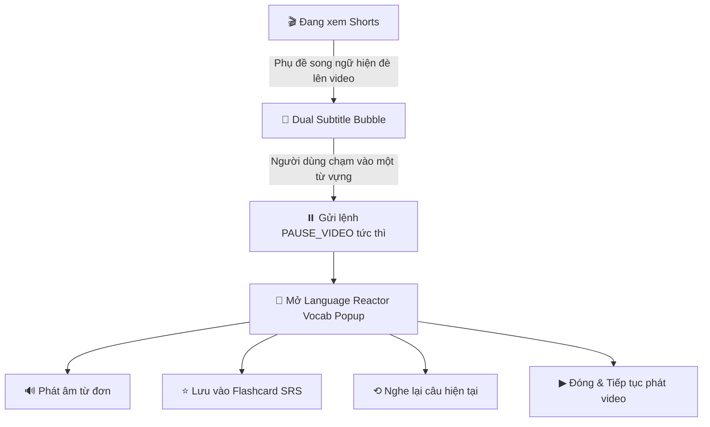

# 🎬 Language Reactor Mobile — Đặc Tả Giao Diện & Tương Tác Học Ngoại Ngữ Qua Shorts

> **Language Reactor (LR)** là tiêu chuẩn vàng thế giới về giao diện học ngôn ngữ qua video (trước đây là *Language Learning with Netflix / YouTube*).  
> Tài liệu này đặc tả cách chuyển đổi toàn bộ trải nghiệm tinh hoa của Language Reactor lên màn hình dọc di động (**YouTube Shorts**), tập trung vào cơ chế cốt lõi: **Chạm vào từ bất kỳ $\rightarrow$ Video lập tức dừng phát $\rightarrow$ Hiện Popup từ điển ngữ cảnh chuyên sâu**.

---

## 🧭 1. Kiến Trúc Trải Nghiệm Người Dùng (Mobile UX Workflow)



---

## 🎨 2. Thiết Kế Giao Diện Theo Phong Cách Language Reactor

### 2.1. Thanh Phụ Đề Kép (Dual Subtitles Strip)
Trên giao diện di động, phụ đề được đặt tại **1/3 dưới màn hình** (trên thanh điều hướng, dưới vùng nội dung chính) với các đặc điểm:

1. **Dòng Tiếng Anh (Target Language - Primary)**:
   - Font chữ to, đậm nét, tương phản cao.
   - Mỗi từ là một khối (Token Pill) có ranh giới rõ ràng.
   - Khi chạm vào từ: có hiệu ứng Highlight đổi màu (Cyan / Emerald Glow) tạo cảm giác xúc giác (tactile feedback).
2. **Dòng Tiếng Việt (Native Language - Secondary)**:
   - Font nhỏ hơn, màu vàng nhạt hổ phách (`#FDE047`) hoặc xám bạc mờ (`#94A3B8`).
   - Có thể bật/tắt (ẩn/hiện) dòng dịch bằng 1 nút chuyển đổi nhanh (chế độ thử thách tự nghe).
3. **Cụm Nút Điều Khiển Tinh Chỉnh (Mini Controls)**:
   - `[ ⟲ ]`: Tua lại đúng đầu câu phụ đề hiện tại.
   - `[ ⏸ / ▶ ]`: Tạm dừng / Tiếp tục phát.
   - `[ ⏭ ]`: Nhảy sang câu phụ đề tiếp theo.
   - `[ ⚡ Auto-Pause ]`: Chế độ tự động dừng sau mỗi câu phụ đề để người học đọc kỹ trước khi phát tiếp (tính năng signature của Language Reactor).

---

## 🔍 3. Cơ Chế "Chạm Từ Tự Động Dừng Video" (Tap-to-Pause Engine)

### 3.1. Luồng Giao Tiếp 2 Chiều Giữa React Native & WebView
- Khi người dùng chạm ngón tay vào từ:
  1. **Bước 1 (Client-side Tap)**: React Native bắt sự kiện `onPress` của từ vừa chạm.
  2. **Bước 2 (Direct Pause Command)**:
     ```javascript
     webViewRef.current.postMessage(JSON.stringify({ action: 'PAUSE_VIDEO' }));
     ```
  3. **Bước 3 (Injected Script Execute)**: Mã JavaScript tiêm trong WebView tìm thẻ `<video>` đang chạy và gọi lệnh:
     ```javascript
     video.pause();
     ```
  4. **Bước 4 (Display Popover)**: Hiển thị Bottom Sheet hoặc Modal từ điển Language Reactor đè lên nửa dưới màn hình.

---

## 📖 4. Chi Tiết Popup Từ Điển Chuẩn Language Reactor

Giao diện thẻ từ điển bật lên khi chạm từ bao gồm 5 khu vực thông tin chuẩn EdTech:

```text
┌─────────────────────────────────────────────────────────────┐
│  ⭐  SERENDIPITY                    [🔊 Nghe phát âm]      │
│  /ˌser.ənˈdɪp.ə.t̬i/   •   [Noun]   •   [B2 - Trung cấp]    │
├─────────────────────────────────────────────────────────────┤
│  📖 ĐỊNH NGHĨA NGỮ CẢNH:                                    │
│  Sự tình cờ may mắn; cơ duyên bất ngờ tìm thấy điều tốt đẹp. │
├─────────────────────────────────────────────────────────────┤
│  🎬 CÂU VÍ DỤ TRONG VIDEO:                                  │
│  "Finding this hidden cafe was pure serendipity."           │
├─────────────────────────────────────────────────────────────┤
│  [ ⟲ Nghe lại câu này ]              [ ⭐ Lưu Flashcard ]  │
│  [ ▶ Đóng & Tiếp tục xem video ]                           │
└─────────────────────────────────────────────────────────────┘
```

### Các trường dữ liệu cốt lõi:
1. **Từ gốc (Headword)**: Chữ in to, màu xanh dương rực rỡ (`#38BDF8`).
2. **Phiên âm IPA**: Hỗ trợ người học phát âm chuẩn giọng Anh - Mỹ.
3. **Từ loại (Part of Speech)**: Danh từ, Động từ, Tính từ, Trạng từ.
4. **Cấp độ từ vựng theo CEFR**: A1, A2, B1, B2, C1, C2 (kèm màu sắc phân cấp độ phổ biến).
5. **Nghĩa tiếng Việt theo ngữ cảnh**: Nghĩa phù hợp nhất với tình huống trong câu thay vì liệt kê 10 nghĩa từ điển chung chung.
6. **Thao tác nhanh**:
   - `⟲ Nghe lại câu này`: Nhảy WebView về `start_time` của câu và phát lại.
   - `⭐ Lưu Flashcard`: Gửi từ vựng vào hệ thống ôn tập ngắt quãng FSRS v5.
   - `▶ Đóng & Tiếp tục`: Ẩn popup và gửi lệnh `RESUME_VIDEO` cho WebView tiếp tục chạy.

---

## 💻 5. Mã Nguồn Thành Phần Giao Diện Thực Thi (Implementation Code)

### 5.1. Component Phụ Đề Song Ngữ LR ([`LanguageReactorOverlay.tsx`](file:///d:/java/app%20short/frontend/src/components/LanguageReactorOverlay.tsx))

```tsx
import React from 'react';
import { View, Text, StyleSheet, TouchableOpacity } from 'react-native';

interface Props {
  currentCue: { start_time: number; end_time: number; en_text: string; vi_text: string } | null;
  onWordPress: (word: string, fullSentence: string) => void;
  onReplayCue: () => void;
  onNextCue: () => void;
  autoPauseEnabled: boolean;
  onToggleAutoPause: () => void;
}

export const LanguageReactorOverlay: React.FC<Props> = ({
  currentCue,
  onWordPress,
  onReplayCue,
  onNextCue,
  autoPauseEnabled,
  onToggleAutoPause,
}) => {
  if (!currentCue) return null;

  // Tách câu thành từng từ riêng biệt để người học chạm vào
  const words = currentCue.en_text.split(/(\s+)/);

  return (
    <View style={styles.container} pointerEvents="box-none">
      <View style={styles.mainStrip}>
        {/* Dòng Tiếng Anh tương tác từng từ */}
        <View style={styles.wordsRow}>
          {words.map((chunk, idx) => {
            if (/^\s+$/.test(chunk)) {
              return <Text key={`space-${idx}`} style={styles.spaceText}> </Text>;
            }
            const cleanWord = chunk.replace(/^[^\w]+|[^\w]+$/g, '');
            return (
              <TouchableOpacity
                key={`word-${idx}`}
                activeOpacity={0.5}
                onPress={() => onWordPress(cleanWord, currentCue.en_text)}
                style={styles.wordPill}
              >
                <Text style={styles.wordText}>{chunk}</Text>
              </TouchableOpacity>
            );
          })}
        </View>

        {/* Dòng Phụ đề Tiếng Việt */}
        <Text style={styles.translationText}>{currentCue.vi_text}</Text>

        {/* Thanh công cụ phụ đề mini kiểu Language Reactor */}
        <View style={styles.controlBar}>
          <TouchableOpacity style={styles.ctrlBtn} onPress={onReplayCue}>
            <Text style={styles.ctrlBtnText}>⟲ Tua lại câu</Text>
          </TouchableOpacity>

          <TouchableOpacity
            style={[styles.ctrlBtn, autoPauseEnabled && styles.ctrlBtnActive]}
            onPress={onToggleAutoPause}
          >
            <Text style={[styles.ctrlBtnText, autoPauseEnabled && styles.ctrlBtnActiveText]}>
              ⏸ Auto-Pause: {autoPauseEnabled ? 'BẬT' : 'TẮT'}
            </Text>
          </TouchableOpacity>

          <TouchableOpacity style={styles.ctrlBtn} onPress={onNextCue}>
            <Text style={styles.ctrlBtnText}>Câu tiếp ⏭</Text>
          </TouchableOpacity>
        </View>
      </View>
    </View>
  );
};

const styles = StyleSheet.create({
  container: {
    position: 'absolute',
    bottom: 80,
    left: 12,
    right: 12,
    alignItems: 'center',
    zIndex: 9999,
  },
  mainStrip: {
    backgroundColor: 'rgba(15, 23, 42, 0.92)', // Dark Slate Glassmorphism
    borderRadius: 16,
    paddingHorizontal: 16,
    paddingVertical: 12,
    borderWidth: 1,
    borderColor: 'rgba(255, 255, 255, 0.18)',
    width: '100%',
    shadowColor: '#000',
    shadowOffset: { width: 0, height: 6 },
    shadowOpacity: 0.5,
    shadowRadius: 10,
    elevation: 10,
  },
  wordsRow: {
    flexDirection: 'row',
    flexWrap: 'wrap',
    justifyContent: 'center',
    alignItems: 'center',
    marginBottom: 6,
  },
  wordPill: {
    paddingVertical: 3,
    paddingHorizontal: 4,
    borderRadius: 6,
    backgroundColor: 'rgba(255, 255, 255, 0.06)',
    marginHorizontal: 1,
    marginVertical: 2,
  },
  wordText: {
    color: '#FFFFFF',
    fontSize: 18,
    fontWeight: '700',
    textShadowColor: 'rgba(0, 0, 0, 0.9)',
    textShadowRadius: 3,
  },
  spaceText: { fontSize: 18 },
  translationText: {
    color: '#FDE047', // Màu vàng hổ phách đặc trưng
    fontSize: 14,
    fontWeight: '600',
    textAlign: 'center',
    marginBottom: 10,
  },
  controlBar: {
    flexDirection: 'row',
    justifyContent: 'space-between',
    borderTopWidth: 1,
    borderTopColor: 'rgba(255, 255, 255, 0.1)',
    paddingTop: 8,
  },
  ctrlBtn: {
    paddingVertical: 5,
    paddingHorizontal: 10,
    borderRadius: 8,
    backgroundColor: 'rgba(255, 255, 255, 0.08)',
  },
  ctrlBtnActive: {
    backgroundColor: 'rgba(56, 189, 248, 0.25)',
    borderColor: '#38BDF8',
    borderWidth: 1,
  },
  ctrlBtnText: {
    color: '#CBD5E1',
    fontSize: 12,
    fontWeight: '600',
  },
  ctrlBtnActiveText: {
    color: '#38BDF8',
    fontWeight: '700',
  },
});
```

---

### 5.2. Modal Tra Từ Ngữ Cảnh Tự Động Dừng Video

```tsx
{/* Modal Language Reactor tra từ vựng khi chạm */}
<Modal
  visible={isModalVisible}
  transparent
  animationType="slide"
  onRequestClose={handleCloseAndResume}
>
  <View style={styles.modalBackdrop}>
    <View style={styles.lrCard}>
      {/* Header từ vựng */}
      <View style={styles.lrHeader}>
        <View>
          <Text style={styles.lrWord}>{selectedWord}</Text>
          <Text style={styles.lrIPA}>/ˈwɜːd/</Text>
        </View>
        <TouchableOpacity style={styles.audioBtn}>
          <Text style={styles.audioBtnText}>🔊 Phát âm</Text>
        </TouchableOpacity>
      </View>

      {/* Nghĩa ngữ cảnh */}
      <View style={styles.lrMeaningBox}>
        <Text style={styles.lrSectionLabel}>ĐỊNH NGHĨA TRONG NGỮ CẢNH:</Text>
        <Text style={styles.lrMeaningText}>{wordMeaning}</Text>
      </View>

      {/* Câu gốc trong video */}
      <View style={styles.lrSentenceBox}>
        <Text style={styles.lrSectionLabel}>CÂU GỐC TRONG VIDEO:</Text>
        <Text style={styles.lrSentenceText}>"{contextSentence}"</Text>
      </View>

      {/* Hàng nút hành động */}
      <View style={styles.lrActionRow}>
        <TouchableOpacity style={styles.replayCueBtn} onPress={handleReplayAndResume}>
          <Text style={styles.replayCueBtnText}>⟲ Nghe lại câu</Text>
        </TouchableOpacity>

        <TouchableOpacity style={styles.saveCardBtn} onPress={handleSaveToSRS}>
          <Text style={styles.saveCardBtnText}>⭐ Lưu Flashcard</Text>
        </TouchableOpacity>
      </View>

      {/* Nút Đóng & Tiếp tục phát video */}
      <TouchableOpacity style={styles.resumeBtn} onPress={handleCloseAndResume}>
        <Text style={styles.resumeBtnText}>▶ Đóng & Tiếp tục phát video</Text>
      </TouchableOpacity>
    </View>
  </View>
</Modal>
```

---

## ⚡ 6. Kịch Bản Tương Tác Thực Tế Của Người Dùng

1. **Lướt xem video Shorts**: Người dùng thấy phụ đề song ngữ hiển thị mượt mà bên dưới.
2. **Bắt gặp từ mới**: Người học chạm ngón tay vào từ `"ephemeral"`.
3. **Phản ứng tức thì (0ms)**:
   - Video YouTube Shorts **lập tức dừng lại**.
   - Khung tra từ vựng Language Reactor trượt lên từ đáy màn hình.
   - Hiển thị phiên âm `/ɪˈfem.ər.əl/`, nghĩa: *"Phù du, ngắn ngủi, thoáng qua"*.
4. **Ôn tập tức thời**:
   - Bấm `[ 🔊 Phát âm ]` để nghe giọng chuẩn.
   - Bấm `[ ⟲ Nghe lại câu ]` để video nhảy lùi lại đầu câu và phát lại đúng câu có chứa từ đó.
   - Bấm `[ ⭐ Lưu Flashcard ]` để lưu vào danh sách ôn tập FSRS v5.
5. **Tiếp tục học**: Bấm `[ ▶ Đóng & Tiếp tục ]`, popup biến mất và video tiếp tục phát bình thường.
