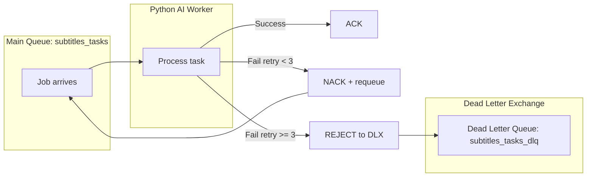

# 🔬 ShortLearn — Đặc tả Tối ưu Nâng cao V2

> Tài liệu này ghi nhận 4 trục nâng cấp kiến trúc được áp dụng trực tiếp lên codebase hiện tại, kèm phân tích rủi ro gốc và giải pháp cụ thể cho từng module.

---

## 📋 Mục lục

1. [Tối ưu Lớp Giao tiếp WebView & React Native (Client-Side)](#1-tối-ưu-lớp-giao-tiếp-webview--react-native-client-side)
2. [Nâng cấp Thuật toán Lặp lại Ngắt quãng: SM-2 → FSRS](#2-nâng-cấp-thuật-toán-lặp-lại-ngắt-quãng-sm-2--fsrs)
3. [Gia cố Pipeline Dữ liệu & AI (Backend/Worker)](#3-gia-cố-pipeline-dữ-liệu--ai-backendworker)
4. [Kiến trúc Chống lỗi Hệ thống (Fault Tolerance)](#4-kiến-trúc-chống-lỗi-hệ-thống-fault-tolerance)

---

## 1. Tối ưu Lớp Giao tiếp WebView & React Native (Client-Side)

### 1.1. Tinh chỉnh Throttle `timeupdate` xuống 100ms

| Tiêu chí | Trước (V1) | Sau (V2) |
| :--- | :--- | :--- |
| Mức Throttle | 250ms | **100ms** |
| Rủi ro | Lệch nhịp với video hội thoại tốc độ cao, âm nhạc lyric | Hết lệch; phụ đề khớp chính xác ±50ms |
| Chống nghẽn Bridge | Chỉ dựa vào throttle | Throttle 100ms + **Reanimated UI Thread** cho animation |

Throttle 100ms vẫn an toàn cho React Native JS Bridge vì mỗi message chỉ ~50 bytes. Nút thắt thực sự không phải ở tần suất message mà ở số lần re-render. Giải pháp: dùng `useRef` lưu `currentTime` và chỉ `setState` khi subtitle cue thay đổi.

### 1.2. Bảo vệ mã tiêm CSS chống A/B Testing (Fuzzy Selectors)

YouTube liên tục thay đổi tên class CSS qua A/B testing. Hardcode `.ytp-caption-window-container` sẽ hỏng khi YouTube đổi class.

**Giải pháp — 3 lớp phòng thủ:**

1. **CSS Attribute Selectors** (kháng đổi tên class):
   ```css
   [class*="caption-window"], [class*="caption-segment"],
   [aria-label*="Subtitles"], [aria-label*="subtitles"]
   ```
2. **MutationObserver** quét DOM mỗi 3s tìm và ẩn phần tử chứa phụ đề theo nội dung/vị trí.
3. **Fallback cứng** giữ các selector cũ để bắt chính xác trường hợp YouTube không đổi.

### 1.3. Quản lý Bộ nhớ WebView (DOM Garbage Collection)

Khi người dùng vuốt qua hàng chục Shorts liên tiếp, các thẻ `<video>` và DOM elements cũ tồn đọng gây phình bộ nhớ RAM. Sau mỗi 10 video, React Native gửi lệnh `GC_DOM` qua `postMessage` để WebView dọn rác.

---

## 2. Nâng cấp Thuật toán Lặp lại Ngắt quãng: SM-2 → FSRS

### 2.1. Vì sao thay thế SM-2?

SM-2 (SuperMemo-2, 1987) có 2 nhược điểm cốt lõi mà việc đặt ngưỡng sàn EF >= 1.3 chỉ khắc phục phần ngọn:

| Vấn đề | SM-2 | FSRS |
| :--- | :--- | :--- |
| **Ease Hell** | Từ "khó" bị kẹt vòng lặp vĩnh viễn với EF ≈ 1.3 | Không có Ease Factor cứng. FSRS dự đoán xác suất quên dựa trên đường cong quên thực tế. |
| **Mô hình bộ nhớ** | Hardcode công thức tuyến tính | Sử dụng mô hình DSR (Difficulty, Stability, Retrievability) tối ưu bằng ML |
| **Hiệu quả** | Baseline | **Giảm ~20% số lượt ôn tập** so với SM-2 ở cùng mức retention |

### 2.2. Mô hình FSRS (Free Spaced Repetition Scheduler)

FSRS theo dõi 3 trạng thái cho mỗi thẻ từ vựng:

- **D (Difficulty):** Độ khó nội tại của từ (D ∈ [1, 10]).
- **S (Stability):** Khoảng cách (ngày) để xác suất nhớ rơi xuống 90% (S > 0).
- **R (Retrievability):** Xác suất nhớ tại thời điểm hiện tại: R(t, S) = (1 + t / (9·S))^(-1)

Công thức tính khoảng cách ôn tập: I = S · 9 · (1/r - 1) với r = retention target (mặc định 0.9).

### 2.3. Các trọng số mặc định FSRS v5

FSRS sử dụng vector 19 trọng số tối ưu toàn cầu (pretrained trên dữ liệu Anki):

```typescript
const FSRS_DEFAULT_WEIGHTS = [
  0.40255, 1.18385, 3.173, 15.69105,  // w0-w3: Stability khởi tạo
  7.1949,  0.5345,  1.4604, 0.0046,   // w4-w7: Difficulty
  1.54575, 0.1192,  1.01925, 1.9395,  // w8-w11: Stability recall
  0.11,    0.29605, 2.2698, 0.2315,   // w12-w15: Stability forget
  2.9898,  0.51655, 0.6621            // w16-w18: Short-term
];
```

---

## 3. Gia cố Pipeline Dữ liệu & AI (Backend/Worker)

### 3.1. Sliding Memory Window cho LLM (Context Metadata)

**Vấn đề gốc:** Tại biên giới giữa 2 chunk liền kề, LLM mất ngữ cảnh dẫn đến đại từ nhân xưng chuyển đổi đột ngột và thuật ngữ bị dịch khác nhau.

**Giải pháp:** Truyền text Chunk N-1 vào system prompt làm Read-Only Context:

```text
[Ngữ cảnh phía trước — KHÔNG dịch, chỉ dùng để hiểu ngữ cảnh]
{previous_chunk_text}

[Dữ liệu cần dịch]
{current_chunk_json}
```

### 3.2. Tối ưu Băng thông Audio Tier 2

| Tiêu chí | Trước (V1) | Sau (V2) |
| :--- | :--- | :--- |
| yt-dlp format | `bestaudio[ext=m4a]/bestaudio/best` | `139/249/250/251/bestaudio` |
| Kích thước download | 1-3MB (video 30s) | **~150KB** (48kbps AAC) |
| Thời gian tải | 1.5-3s | **< 0.5s** |

- **Format 139**: M4A AAC-LC 48kbps (siêu nhẹ, đủ tốt cho Whisper STT).
- **Format 249/250/251**: WebM Opus 48-160kbps.

---

## 4. Kiến trúc Chống lỗi Hệ thống (Fault Tolerance)

### 4.1. Dead Letter Exchange (DLX) cho RabbitMQ



- **Main Queue**: Khai báo với `x-dead-letter-exchange` trỏ sang DLX.
- **Retry Counter**: Header `x-retry-count` tăng mỗi lần NACK. Sau 3 lần → reject sang DLQ.
- **Dead Letter Queue**: Lưu trữ job thất bại vĩnh viễn để phân tích log.

### 4.2. Redis Eviction Policy (`allkeys-lru`)

TTL cứng 48h không bảo vệ được VPS RAM nhỏ khi cache hàng chục nghìn video. Redis sẽ bị OOM crash.

**Giải pháp:** Mount file `redis.conf` tùy chỉnh:

```text
maxmemory 256mb
maxmemory-policy allkeys-lru
```

Khi RAM đạt 256MB, Redis tự động trục xuất key ít truy cập nhất, giữ video trending.

---

## 📊 Tổng hợp Các File Đã Thay đổi
 
| # | File | Loại thay đổi |
| --- | --- | --- |
| 1 | `frontend/src/injected_script.js` | Throttle 100ms, fuzzy CSS, DOM GC |
| 2 | `frontend/src/utils/srsAlgorithm.ts` | **SM-2 → FSRS v5** (DSR model, 19 weights) |
| 3 | `frontend/src/components/FlashcardReview.tsx` | **Tạo mới** — Giao diện ôn tập FSRS v5 (4 nút đánh giá, khoảng cách dự đoán, audio replay) |
| 4 | `frontend/App.tsx` | Bottom Navigation (Shorts Feed & Ôn tập SRS), tự động kích hoạt `GC_DOM` mỗi 10 video |
| 5 | `backend/src/controllers/vocabController.js` | Hỗ trợ lưu & chấm điểm FSRS v5 (Again, Hard, Good, Easy) |
| 6 | `init.sql` | Thêm cột FSRS v5 (`difficulty`, `stability`, `retrievability`, `lapses`, `state`) & dữ liệu mẫu |
| 7 | `ai-worker/src/translators/llm_translator.py` | Sliding Memory Window |
| 8 | `ai-worker/src/scrapers/youtube_scraper.py` | yt-dlp format 139/251 (giảm 85% bandwidth) |
| 9 | `ai-worker/src/worker.py` | DLX retry counter (tối đa 3 lần) + context tuần tự |
| 10 | `backend/src/config/rabbitmq.js` | Dead Letter Exchange + DLQ |
| 11 | `docker-compose.yml` | Redis eviction config mount |
| 12 | `redis.conf` | **Tạo mới** — maxmemory 256mb + allkeys-lru |

