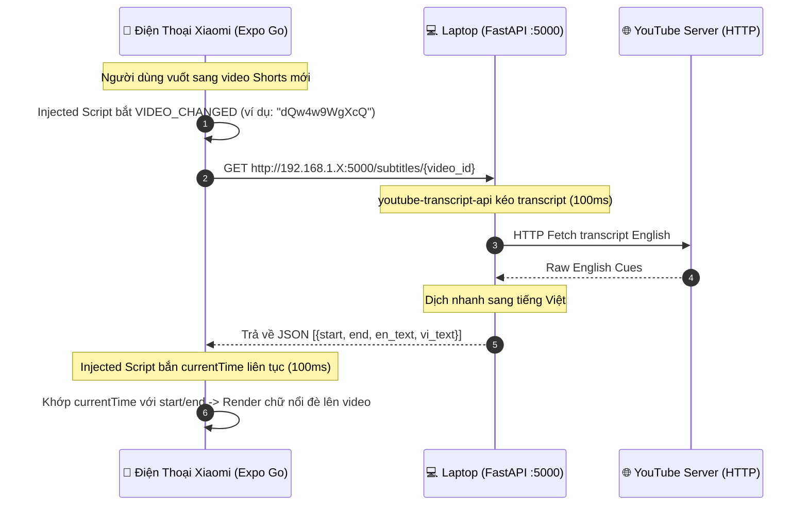

# 🎯 ShortLearn Local POC — Kế Hoạch Triển Khai "Du Kích" 1 Buổi Tối

> **Mục tiêu duy nhất:** Cầm điện thoại Xiaomi lướt video YouTube Shorts và thấy phụ đề song ngữ Anh - Việt hiện đè lên video thời gian thực.  
> **Nguyên tắc "Du kích":** Zero Docker • Zero Database • Zero RabbitMQ • Zero Redis • Không chia Tab • Không Flashcard. Chỉ 2 thành phần giao tiếp trực tiếp qua mạng Wi-Fi cục bộ (LAN).

---

## 📐 1. Sơ Đồ Kiến Trúc Siêu Tối Giản



---

## 💻 2. Trạm Xử Lý Backend (Chạy trên Laptop)

Dựng một API duy nhất bằng **Python 3 + FastAPI** siêu nhẹ, không cần bất kỳ cơ sở dữ liệu hay container nào.

### 2.1. Cài đặt thư viện cần thiết
Mở Terminal (PowerShell / Command Prompt) trên Laptop và chạy:

```bash
pip install fastapi uvicorn youtube-transcript-api deep-translator
```
*(Khuyên dùng `deep-translator` vì hoạt động cực kỳ ổn định, tự động gọi Google Translate miễn phí mà không bao giờ bị lỗi token như bản `googletrans` cũ).*

### 2.2. Code `poc_server.py` (Đặt ngay tại thư mục gốc dự án)

```python
from fastapi import FastAPI, HTTPException
from fastapi.middleware.cors import CORSMiddleware
from youtube_transcript_api import YouTubeTranscriptApi
from deep_translator import GoogleTranslator
import uvicorn
import re

app = FastAPI(title="ShortLearn Guerrilla POC")

# Mở CORS toàn bộ để Mobile trong mạng LAN truy cập thoải mái
app.add_middleware(
    CORSMiddleware,
    allow_origins=["*"],
    allow_credentials=True,
    allow_methods=["*"],
    allow_headers=["*"],
)

translator = GoogleTranslator(source='en', target='vi')

@app.get("/")
def home():
    return {"status": "ShortLearn Guerrilla Backend is RUNNING!"}

@app.get("/subtitles/{video_id}")
def get_subtitles(video_id: str):
    """
    1. Kéo transcript gốc từ YouTube bằng youtube-transcript-api (~100ms)
    2. Gộp câu ngắn và dịch nhanh sang tiếng Việt
    3. Trả về JSON chuẩn cho Mobile
    """
    try:
        print(f"📥 [Request] Fetching subtitles for video: {video_id}")
        
        # 1. Kéo phụ đề tiếng Anh (ưu tiên manual track, fallback auto-generated)
        transcript_list = YouTubeTranscriptApi.list_transcripts(video_id)
        try:
            transcript = transcript_list.find_manually_created_transcript(['en', 'en-US'])
        except Exception:
            transcript = transcript_list.find_generated_transcript(['en', 'en-US'])
            
        raw_cues = transcript.fetch()
        
        # 2. Gộp các cue ngắn thành câu có nghĩa (5-10s / câu)
        merged_cues = []
        current_chunk = {
            "start": round(raw_cues[0]["start"], 2),
            "end": round(raw_cues[0]["start"] + raw_cues[0]["duration"], 2),
            "text": raw_cues[0]["text"].strip()
        }
        
        sentence_end = re.compile(r'[.!?]$')
        for cue in raw_cues[1:]:
            cue_start = round(cue["start"], 2)
            cue_end = round(cue_start + cue["duration"], 2)
            cue_text = cue["text"].strip()
            
            duration = cue_end - current_chunk["start"]
            is_end = bool(sentence_end.search(current_chunk["text"]))
            
            if (is_end and duration >= 5.0) or duration >= 12.0:
                merged_cues.append(current_chunk)
                current_chunk = {"start": cue_start, "end": cue_end, "text": cue_text}
            else:
                current_chunk["text"] += " " + cue_text
                current_chunk["end"] = cue_end
                
        if current_chunk["text"]:
            merged_cues.append(current_chunk)
            
        # 3. Dịch nhanh sang tiếng Việt
        results = []
        for idx, item in enumerate(merged_cues):
            en_text = item["text"]
            try:
                vi_text = translator.translate(en_text)
            except Exception:
                vi_text = en_text # Fallback nếu lỗi mạng dịch
                
            results.append({
                "cue_index": idx,
                "start_time": item["start"],
                "end_time": item["end"],
                "en_text": en_text,
                "vi_text": vi_text
            })
            
        print(f"✅ [Success] Generated {len(results)} bilingual cues for {video_id}")
        return {"status": "READY", "video_id": video_id, "data": results}

    except Exception as e:
        print(f"⚠️ [Subtitle Error] {video_id}: {str(e)}")
        raise HTTPException(status_code=404, detail=f"No subtitles found: {str(e)}")

if __name__ == "__main__":
    uvicorn.run(app, host="0.0.0.0", port=5000)
```

### 2.3. Lệnh khởi chạy server
```bash
uvicorn poc_server:app --host 0.0.0.0 --port 5000 --reload
```
> **Quan trọng:** Ghi lại địa chỉ **IPv4 của Laptop** bằng lệnh `ipconfig` (ví dụ: `192.168.1.15`).

---

## 📱 3. Giao Diện Client Độc Bản (Chạy trên Điện Thoại Xiaomi)

Toàn bộ ứng dụng gói gọn trong **1 màn hình duy nhất** tại `frontend/App.tsx`:
- Mở toàn màn hình `https://m.youtube.com/shorts`.
- Bắt sự kiện chuyển Shorts và thời gian video.
- Hiển thị phụ đề đè lên video.

### 3.1. Code tối giản cho `frontend/App.tsx`

```tsx
import React, { useState, useRef } from 'react';
import { StyleSheet, View, Text, SafeAreaView, StatusBar, ActivityIndicator } from 'react-native';
import { WebView } from 'react-native-webview';

// ⚠️ THAY BẰNG IP LAN MÁY TÍNH CỦA BẠN (Kiểm tra bằng lệnh ipconfig)
const LAPTOP_IP = '192.168.1.15'; // Ví dụ: 192.168.1.X
const API_URL = `http://${LAPTOP_IP}:5000/subtitles`;

// Đoạn Script tiêm vào YouTube Shorts: Ẩn thanh công cụ + Bắt chuyển video + Đo thời gian
const INJECTED_SCRIPT = `
(function() {
  // 1. Ẩn thanh công cụ thừa của YouTube Mobile
  const style = document.createElement('style');
  style.innerHTML = \`
    ytm-mobile-topbar-renderer, .pivot-bar-renderer, ytm-pivot-bar-renderer,
    button[aria-label="Open App"], .action-sheet-renderer, .ytp-subtitles-button,
    .ytp-caption-window-container, .caption-window { display: none !important; }
    body { overflow: hidden !important; }
  \`;
  document.head.appendChild(style);

  // 2. Bắt sự kiện chuyển Shorts (SPA pushState & replaceState)
  let lastId = '';
  const checkVideoChange = () => {
    const match = location.pathname.match(/\\/shorts\\/([a-zA-Z0-9_-]+)/);
    if (match && match[1] && match[1] !== lastId) {
      lastId = match[1];
      window.ReactNativeWebView.postMessage(JSON.stringify({ type: 'VIDEO_CHANGED', videoId: lastId }));
    }
  };
  const origPush = history.pushState;
  history.pushState = function() { origPush.apply(this, arguments); checkVideoChange(); };
  const origReplace = history.replaceState;
  history.replaceState = function() { origReplace.apply(this, arguments); checkVideoChange(); };
  window.addEventListener('popstate', checkVideoChange);
  setInterval(checkVideoChange, 400);

  // 3. Đo video.currentTime (Throttle 100ms)
  let lastTime = 0;
  setInterval(() => {
    const video = Array.from(document.querySelectorAll('video')).find(v => !v.paused && v.readyState >= 2) || document.querySelector('video');
    if (video && Math.abs(video.currentTime - lastTime) >= 0.1) {
      lastTime = video.currentTime;
      window.ReactNativeWebView.postMessage(JSON.stringify({
        type: 'TIME_UPDATE',
        time: Number(video.currentTime.toFixed(2))
      }));
    }
  }, 100);
})();
true;
`;

export default function App() {
  const [subtitles, setSubtitles] = useState([]);
  const [activeCue, setActiveCue] = useState(null);
  const [loading, setLoading] = useState(false);

  const fetchSubtitles = async (videoId) => {
    try {
      setLoading(true);
      setActiveCue(null);
      const res = await fetch(`${API_URL}/${videoId}`);
      if (res.ok) {
        const json = await res.json();
        setSubtitles(json.data || []);
      } else {
        setSubtitles([]);
      }
    } catch (err) {
      console.warn('Lỗi kết nối Backend Laptop:', err);
      setSubtitles([]);
    } finally {
      setLoading(false);
    }
  };

  const handleMessage = (event) => {
    try {
      const data = JSON.parse(event.nativeEvent.data);
      if (data.type === 'VIDEO_CHANGED') {
        fetchSubtitles(data.videoId);
      } else if (data.type === 'TIME_UPDATE') {
        const t = data.time;
        const found = subtitles.find(c => t >= c.start_time && t <= c.end_time);
        setActiveCue(found || null);
      }
    } catch (e) {}
  };

  return (
    <SafeAreaView style={styles.container}>
      <StatusBar barStyle="light-content" backgroundColor="#000" />
      
      {/* 1. Màn hình WebView YouTube Shorts */}
      <WebView
        source={{ uri: 'https://m.youtube.com/shorts' }}
        userAgent="Mozilla/5.0 (Linux; Android 13; Mobile) AppleWebKit/537.36 (KHTML, like Gecko) Chrome/120.0.0.0 Mobile Safari/537.36"
        injectedJavaScriptBeforeContentLoaded={INJECTED_SCRIPT}
        onMessage={handleMessage}
        style={styles.webView}
        allowsInlineMediaPlayback
        mediaPlaybackRequiresUserAction={false}
      />

      {/* 2. Loading Badge khi kéo phụ đề */}
      {loading && (
        <View style={styles.loadingBox}>
          <ActivityIndicator size="small" color="#38BDF8" />
          <Text style={styles.loadingText}>Đang lấy phụ đề AI...</Text>
        </View>
      )}

      {/* 3. Lớp hiển thị phụ đề song ngữ đè lên video */}
      {activeCue && (
        <View style={styles.subtitleOverlay} pointerEvents="none">
          <View style={styles.subtitleCard}>
            <Text style={styles.enText}>{activeCue.en_text}</Text>
            <Text style={styles.viText}>{activeCue.vi_text}</Text>
          </View>
        </View>
      )}
    </SafeAreaView>
  );
}

const styles = StyleSheet.create({
  container: { flex: 1, backgroundColor: '#000' },
  webView: { flex: 1, backgroundColor: '#000' },
  loadingBox: {
    position: 'absolute', top: 30, right: 16,
    flexDirection: 'row', alignItems: 'center',
    backgroundColor: 'rgba(0,0,0,0.7)',
    paddingHorizontal: 12, paddingVertical: 6, borderRadius: 20,
  },
  loadingText: { color: '#38BDF8', fontSize: 12, marginLeft: 6, fontWeight: '600' },
  subtitleOverlay: {
    position: 'absolute', bottom: 85, left: 16, right: 16,
    alignItems: 'center', zIndex: 9999,
  },
  subtitleCard: {
    backgroundColor: 'rgba(15, 23, 42, 0.85)',
    borderRadius: 12, paddingHorizontal: 16, paddingVertical: 10,
    borderWidth: 1, borderColor: 'rgba(255, 255, 255, 0.2)',
    alignItems: 'center', maxWidth: '100%',
  },
  enText: {
    color: '#FFF', fontSize: 18, fontWeight: '700',
    textAlign: 'center', marginBottom: 4,
    textShadowColor: 'rgba(0,0,0,0.8)', textShadowRadius: 3,
  },
  viText: {
    color: '#FDE047', fontSize: 14, fontWeight: '500',
    textAlign: 'center',
  },
});
```

---

## ⚡ 4. Quy Trình 3 Bước Thực Thi Trong 5 Phút

### Bước 1: Khởi động Backend trên Laptop
```bash
# Tại thư mục gốc dự án:
uvicorn poc_server:app --host 0.0.0.0 --port 5000 --reload
```
Kiểm tra thử trên trình duyệt Laptop:  
👉 `http://localhost:5000/api/v1/subtitles/dQw4w9WgXcQ`  
Nếu thấy trả về danh sách JSON chứa `en_text` và `vi_text` là Backend đã hoàn tất 100%!

### Bước 2: Kiểm tra kết nối từ Điện thoại vào Laptop
1. Kết nối Điện thoại Xiaomi và Laptop vào **cùng một mạng Wi-Fi**.
2. Mở trình duyệt Chrome trên điện thoại Xiaomi, nhập:  
   👉 `http://192.168.1.X:5000/` *(thay `192.168.1.X` bằng IP Laptop của bạn)*.
3. Nếu màn hình điện thoại hiện `{"status": "ShortLearn Guerrilla Backend is RUNNING!"}` là kết nối mạng LAN thông suốt!

### Bước 3: Chạy Expo App & Thưởng thức
```bash
cd frontend
npx expo start
```
- Mở app **Expo Go** trên điện thoại Xiaomi, quét mã QR.
- Ứng dụng sẽ mở thẳng giao diện YouTube Shorts.
- **Thao tác:** Lướt video Shorts bất kỳ (video tiếng Anh), phụ đề song ngữ sẽ lập tức nổi lên đè trên video theo thời gian thực!

---

## 🛠️ 5. Xử Lý Trục Trặc Thường Gặp (Troubleshooting)

| Tình huống | Nguyên nhân | Cách khắc phục tức thì |
| :--- | :--- | :--- |
| **Điện thoại báo lỗi mạng / không tải được phụ đề** | Windows Firewall chặn cổng 5000 | Tạm tắt Windows Firewall hoặc tạo rule Allow inbound port 5000. |
| **Điện thoại không ping được IP Laptop** | Laptop và Điện thoại khác mạng Wi-Fi (ví dụ: máy dùng 2.4GHz, máy dùng 5GHz) | Kết nối cả 2 thiết bị vào cùng 1 tên Wi-Fi (SSID). |
| **Video không hiện phụ đề** | Video Shorts đó là nhạc nền, người sáng tạo không bật phụ đề gốc | Lướt sang các kênh Shorts tiếng Anh có lời nói rõ ràng (ví dụ: MrBeast, TED-Ed, Learn English with TV Series). |
