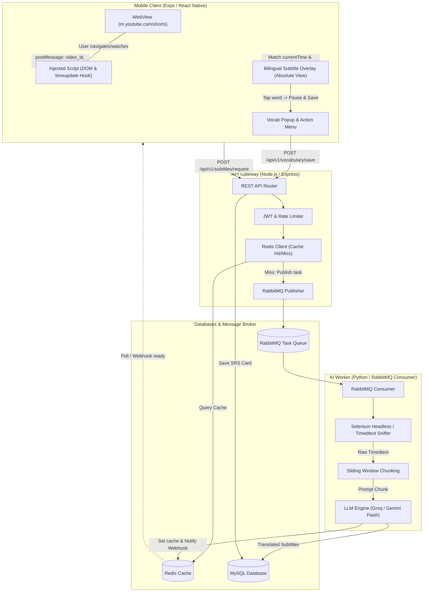
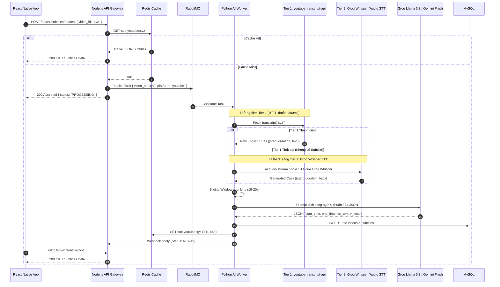

# 📱 ShortLearn — Lộ trình Phát triển & Đặc tả Kỹ thuật Hệ thống

> **ShortLearn**: Ứng dụng học tiếng Anh thông minh qua video ngắn (YouTube Shorts) tích hợp phụ đề song ngữ AI và hệ thống lặp lại ngắt quãng (Spaced Repetition System - SRS).

---

## 🧭 Kế hoạch mở rộng màn hình & xác thực — 05/10/2026

**Mục tiêu:** hoàn thiện ShortLearn thành ứng dụng nhiều người dùng có onboarding, xác thực, khám phá nội dung, hồ sơ và trạng thái offline đầy đủ mà không làm nặng lại luồng Shorts/WebView.

### Hiện trạng và quyết định sản phẩm

| Nhóm chức năng | Hiện trạng 05/10/2026 | Quyết định triển khai | Ưu tiên |
| :--- | :--- | :--- | :--- |
| Splash Screen | Đã tích hợp `expo-splash-screen`, chưa có luồng phục hồi phiên và giao diện thương hiệu hoàn chỉnh. | Giữ splash đúng thời gian khởi tạo thực tế; không cố tình chờ đủ 3 giây. | P1 |
| Onboarding | Chưa có. | Thêm 3 màn giới thiệu, chỉ xuất hiện lần đầu và có nút bỏ qua. | P1 |
| Xác thực ứng dụng | Chưa có auth người dùng; Google Sign-In hiện chỉ dùng để liên kết YouTube. Client vẫn gửi cố định `user_id=1`. | Xây auth backend, JWT/refresh token và thay toàn bộ `user_id=1` bằng danh tính từ token trước khi phát hành nhiều người dùng. | P0 — bắt buộc |
| Shorts/Home | Đã có YouTube/TikTok, phụ đề song ngữ, transcript, tra từ và điều hướng video. | Giữ làm màn hình chính; WebView tiếp tục được cô lập và tạm dừng khi rời tab. | Đang hoạt động |
| Explore | Chưa có màn khám phá tổng hợp; tìm kiếm hiện chỉ nằm trong danh sách từ đã lưu. | Thêm tìm video/link, chủ đề, lịch sử gần đây và nội dung đề xuất. | P2 |
| Review | Đã có Saved Items, tìm kiếm, bộ lọc, FSRS và Audio Context Replay. | Giữ và tách thành `ReviewScreen`; bổ sung review plan theo ngày. | Đang hoạt động |
| Notifications | Chưa có push hoặc hộp thư hoạt động. | Giai đoạn đầu dùng biểu tượng chuông; hỗ trợ nhắc lịch ôn và báo phụ đề AI hoàn tất. | P3 |
| Profile | Mới có trang kết nối YouTube/TikTok. | Nâng thành hồ sơ người học: avatar, streak, thống kê và tài khoản nền tảng. | P2 |
| Settings | Có cài đặt hiển thị từ vựng nằm trong trang tài khoản. | Tách thành màn riêng: ngôn ngữ, giao diện, phụ đề, auto-pause, thông báo, quyền riêng tư và xóa tài khoản. | P2 |
| Empty/Error | Đã có một phần ở transcript, Saved Items và Flashcard Review. | Chuẩn hóa component dùng chung cho loading, empty, error và retry. | P1 |
| Offline | Chưa có giám sát kết nối toàn cục và cache hành động. | Thêm banner mất mạng, dữ liệu gần nhất, hàng đợi đồng bộ và nút **Thử lại**. | P3 |

### Kiến trúc điều hướng mục tiêu

```text
Root
├── Bootstrap
│   └── Splash → kiểm tra onboarding + phục hồi phiên
├── Onboarding (chỉ lần đầu)
│   ├── Học qua YouTube/TikTok Shorts
│   ├── Phụ đề song ngữ và chạm để tra từ
│   └── Lưu từ và ôn tập thông minh
├── Auth
│   ├── Đăng nhập
│   ├── Đăng ký
│   ├── Email OTP / Magic Link
│   ├── Quên mật khẩu
│   └── Tiếp tục với tư cách khách
└── Main Tabs
    ├── Shorts
    ├── Khám phá
    ├── Ôn tập
    └── Cá nhân
        ├── Tài khoản YouTube/TikTok
        └── Cài đặt
```

**Quyết định UX:** thanh dưới giữ tối đa 4 tab. Thông báo dùng biểu tượng chuông ở header thay vì chiếm một tab riêng. GitHub Sign-In không phù hợp nhóm người học phổ thông nên chưa triển khai; Facebook để ở backlog. MVP ưu tiên Google, Email OTP/Magic Link và chế độ khách.

### Lộ trình triển khai

#### P0 — Nền tảng kiến trúc và bảo mật danh tính

- [x] Tách `shortlearn-app/App.tsx` thành `screens/`, `navigation/`, `hooks/`, `providers/` và các component dùng chung.
- [x] Thiết lập `AuthStack`, `MainTabs` và typed route params; không tạo lại WebView khi chuyển màn không liên quan.
- [x] Thêm bảng/thuộc tính auth cần thiết cho người dùng, phiên đăng nhập, OTP và refresh token.
- [x] Thêm endpoint đăng ký, đăng nhập, OTP, refresh, đăng xuất và quên mật khẩu.
- [x] Thêm middleware xác thực JWT; API nghiệp vụ lấy `user_id` từ token, không nhận `user_id` tùy ý từ client.
- [ ] Thay toàn bộ `user_id=1` trong mobile bằng `AuthContext` và dữ liệu phiên hiện tại.
- [ ] Lưu access/refresh token bằng Secure Store; hỗ trợ thu hồi phiên và đăng xuất trên thiết bị.
- [ ] Bổ sung rate limit, hash mật khẩu và kiểm thử quyền truy cập chéo người dùng.

**Cổng nghiệm thu P0:** người dùng A không đọc/sửa được từ vựng của người dùng B; refresh token hoạt động; API cũ không còn tin `user_id` từ query/body.

**Xác minh điều hướng 05/10/2026:** `tsc --noEmit` và `assembleRelease` đạt. APK release đã được cài lên `emulator-5554`; ba route Shorts/Đã lưu/Tài khoản mở đúng. Tiến trình WebView sandbox giữ nguyên PID qua vòng chuyển tab Shorts → Đã lưu → Tài khoản → Shorts, xác nhận WebView không bị unmount/recreate. `AuthStack` đã đăng ký typed routes cho Sign In, Sign Up, OTP, Forgot Password và Main; giao diện/xử lý auth thật tiếp tục ở các checklist backend phía dưới.

**Xác minh schema auth 05/10/2026:** `init.sql` đã có user auth metadata, external identities, device sessions, refresh-token rotation history và OTP challenges; raw refresh token/OTP không được lưu. Migration idempotent `backend/migrations/003_auth_foundation.sql` dành cho database hiện có. `npm run check` và 23/23 kiểm thử backend đạt. Môi trường hiện tại không có Docker/MySQL CLI nên migration chưa được thực thi trên MySQL thật; cần backup rồi chạy migration `003` ở môi trường database trước khi deploy API auth.

**Xác minh endpoint auth 05/10/2026:** backend đã có các route `register`, `login`, `otp/request`, `otp/verify`, `forgot-password`, `reset-password`, `refresh` và `logout` dưới `/api/v1/auth`. Mật khẩu dùng scrypt có salt; OTP dùng HMAC, TTL, cooldown và giới hạn lần thử; refresh token dùng SHA-256, rotation và thu hồi cả phiên khi phát hiện tái sử dụng. Reset mật khẩu tăng `auth_version` và thu hồi mọi phiên cũ. `npm run check`, 33/33 kiểm thử và `npm audit` đều đạt; kiểm thử tích hợp với MySQL thật vẫn cần thực hiện sau khi chạy migration `003` trong môi trường có database.

**Xác minh ranh giới JWT 05/10/2026:** toàn bộ route `/api/v1/vocabulary/*` và `/api/v1/learning/*` chạy qua `authenticateJwt` trước controller. Middleware khóa thuật toán/issuer/audience/expiry của JWT rồi đối chiếu `session_key`, trạng thái phiên, hạn phiên, trạng thái user và `auth_version` trong MySQL; logout/reset mật khẩu vì vậy vô hiệu hóa access token ngay ở request kế tiếp. Controller chỉ dùng `req.auth.userId`; request chứa `user_id`/`userId` trong query, body hoặc params bị trả `400`. Kiểm thử bao gồm token lỗi, phiên không còn hoạt động, chặn client chọn danh tính và truy vấn luôn khóa theo user từ token; `npm run check`, 39/39 kiểm thử và `npm audit` đều đạt.

#### P1 — Bootstrap, Splash, Onboarding và trạng thái giao diện

- [ ] Splash giữ đến khi hoàn tất đọc Secure Store, trạng thái onboarding và cấu hình thiết yếu; mục tiêu dưới 2 giây trong điều kiện bình thường.
- [ ] Onboarding 3 trang có Skip/Next/Get Started và chỉ hiện lần đầu; cho phép mở lại trong Settings.
- [ ] Hoàn thiện Login, Sign Up, OTP, Forgot Password, Google Sign-In và chế độ khách.
- [ ] Tạo bộ component `LoadingState`, `EmptyState`, `ErrorState`, `OfflineBanner` và `RetryButton`.
- [ ] Chuẩn hóa thông báo lỗi thân thiện; không hiển thị stack trace hoặc lỗi nhà cung cấp cho người dùng.

**Cổng nghiệm thu P1:** cold start, first install, returning user, token hết hạn và đăng nhập thất bại đều có luồng xác định, không xuất hiện màn trắng.

#### P2 — Điều hướng chính, Explore, Profile và Settings

- [ ] Chuyển bottom navigation thành 4 tab: **Shorts · Khám phá · Ôn tập · Cá nhân**.
- [ ] `ExploreScreen`: tìm theo URL/từ khóa, bộ lọc nền tảng, chủ đề gợi ý và lịch sử gần đây.
- [ ] `ProfileScreen`: avatar, tên, streak, tổng từ đã lưu, số thẻ đến hạn và lịch sử học.
- [ ] Di chuyển kết nối YouTube/TikTok hiện có vào Profile mà không trộn phiên nền tảng với phiên ShortLearn.
- [ ] `SettingsScreen`: ngôn ngữ, dark mode, cài đặt phụ đề, auto-pause, push notification, quyền riêng tư, đăng xuất và xóa tài khoản.
- [ ] Giữ `FlashList`/virtualization cho danh sách dài; không render toàn bộ transcript, lịch sử hoặc kết quả tìm kiếm cùng lúc.

**Cổng nghiệm thu P2:** chuyển tab không reload video ngoài ý muốn; vị trí transcript và bộ lọc Review được giữ; thao tác back trên Android đúng theo stack.

#### P3 — Notifications, offline và đồng bộ dữ liệu

- [ ] Tích hợp push notification cho lịch ôn và trạng thái xử lý phụ đề; xin quyền theo ngữ cảnh, không hỏi ngay ở lần mở đầu tiên.
- [ ] Thêm Notification Center với trạng thái đã đọc/chưa đọc và deep link tới Review hoặc video liên quan.
- [ ] Phát hiện offline toàn cục; hiển thị dữ liệu cache và banner không chặn thao tác.
- [ ] Hàng đợi cục bộ cho thao tác lưu từ/chấm FSRS khi mất mạng; đồng bộ lại idempotent khi có kết nối.
- [ ] Nút **Thử lại** cho lỗi mạng/server; phân biệt offline, timeout, unauthorized và lỗi dịch vụ AI.
- [ ] Chưa dùng WebSocket cho MVP; chỉ bổ sung realtime socket khi có use case cần cập nhật tức thời liên tục.

**Cổng nghiệm thu P3:** người dùng có thể xem dữ liệu đã cache và chấm thẻ khi mất mạng; dữ liệu không bị nhân đôi sau khi kết nối lại.

#### P4 — Hardening trước production

- [ ] Kiểm thử unit/integration cho auth, navigation, deep link, offline queue và phân quyền dữ liệu.
- [ ] Kiểm thử E2E các luồng first install → onboarding → auth → Shorts → lưu từ → Review.
- [ ] Kiểm tra accessibility: nhãn nút, cỡ chữ, độ tương phản, vùng chạm và screen reader.
- [ ] Đo cold start, memory WebView, janky frames và thời gian phản hồi API trên thiết bị Android thật cấu hình thấp/trung bình.
- [ ] Thiết lập crash reporting, log đã ẩn dữ liệu nhạy cảm và chỉ số sức khỏe sản phẩm.
- [ ] Hoàn thiện chính sách quyền riêng tư, điều khoản sử dụng và quy trình xóa tài khoản/dữ liệu.

### Nguyên tắc hiệu năng bắt buộc

- WebView không re-render theo `TIME_UPDATE`, thay đổi cue hoặc trạng thái của các màn khác.
- Khi rời tab Shorts hoặc app xuống nền: pause video, dừng bridge polling và hạn chế MutationObserver.
- Danh sách từ, transcript, kết quả Explore và Notifications phải dùng virtualization/phân trang.
- Không chặn Splash bằng request mạng không thiết yếu; dùng dữ liệu local trước rồi đồng bộ nền.
- Mọi request có timeout, khả năng hủy và chống gửi trùng; không đưa khóa AI/OAuth secret vào mobile bundle.

---

## 🟠 Giai đoạn học tập & thẻ màu — 04/10/2026

**Mục tiêu:** giữ tương thích với các nhãn màu cũ nhưng tách chúng khỏi trạng thái học và lịch ôn FSRS.

| Hạng mục | Quyết định triển khai | Trạng thái |
| :--- | :--- | :--- |
| Màu giai đoạn | `known` hiển thị trắng, `learning` hiển thị cam, `later` hiển thị xám; từ chưa có bản ghi hiển thị trắng trung tính/gợi ý. | Hoàn thành |
| Thẻ màu cũ | `red`, `green`, `yellow`, `blue` chỉ hiển thị bằng gạch chân dưới từ, không thay đổi màu chữ. | Hoàn thành |
| Chuyển đổi hàng loạt | Trong **Saved items → Saved words**, người dùng lọc theo nhãn màu, chọn từng mục hoặc chọn tất cả mục đang hiển thị, chọn Giai đoạn học tập rồi áp dụng. | Hoàn thành |
| Tùy chọn hiển thị | Có công tắc tô màu theo giai đoạn, gạch chân màu thẻ và nhấn giữ để đổi nhãn; tùy chọn được lưu an toàn trên thiết bị. | Hoàn thành |
| Dữ liệu/API | Thêm `learning_stage`, `card_label`, migration idempotent và `PATCH /api/v1/vocabulary/cards`; giữ độc lập với `state`/`srs_stage` của FSRS. | Hoàn thành |
| Kích thước vốn từ | Đã lưu mốc ước tính 1k/3k/5k/10k trong cài đặt. Việc tự suy luận từ đã biết theo tần suất cần bổ sung bộ dữ liệu frequency-rank có giấy phép. | Nền tảng hoàn thành |
| Điều hướng mobile | Thanh Shorts/Đã lưu/Tài khoản có nút `×` phía trên để ẩn; khi thu gọn chỉ còn nút `⌃ Menu` nhỏ để mở lại. | Hoàn thành |

**Xác minh:** frontend `tsc --noEmit` đạt; backend kiểm tra cú pháp đạt; 16/16 bài kiểm thử đạt, bao gồm validation metadata và tính nguyên tử/rollback của cập nhật hàng loạt. Development build đã được mở và kiểm thử thao tác đóng/mở thanh điều hướng trên emulator Android Studio qua ADB (`emulator-5554`).

---

## 🎨 Cập nhật giao diện Saved Items — Tháng 10/2026

**Mục tiêu:** Chuyển tab ôn tập thành không gian “Đã lưu” ưu tiên đọc, lấy cảm hứng từ cách Language Reactor tổ chức từ/cụm có ngữ cảnh; không sao chép nội dung hoặc thương hiệu của bên thứ ba.

| Hạng mục | Quyết định triển khai | Trạng thái |
| :--- | :--- | :--- |
| Danh sách mục đã lưu | Dùng bố cục danh sách/bảng gọn: tab Saved words/Phrases, bộ lọc, tìm kiếm, cột stage/source và không dùng các thẻ lớn gây rối. | Hoàn thành |
| Màu và khả năng đọc | Nền xám nhạt `#F5F5F8`, chữ chính `#3C3D51`, nghĩa/câu `#5E6074`, marker từ xanh `#3E93D1` và nút phát tím `#8064C4`. | Hoàn thành |
| Ngữ cảnh học | Mỗi hàng hiển thị nghĩa, câu phụ đề có tô từ được lưu, nguồn YouTube/mốc thời gian và nút phát để mở lại đúng ngữ cảnh. | Hoàn thành |
| Phân biệt loại mục | Dùng marker xanh `w` cho từ; giữ vị trí tab Phrases và kiến trúc dữ liệu sẵn sàng cho marker tím `p` khi bổ sung cụm từ đã lưu. | Hoàn thành một phần |
| Luồng FSRS | Nút **Ôn ngay** mở bộ thẻ đến hạn, giữ bốn mức đánh giá FSRS và quay lại danh sách bằng một thao tác. | Hoàn thành |
| API | Thêm `GET /api/v1/vocabulary/saved?user_id={id}&limit={1..200}` trả danh sách đã phân trang kèm `is_due`, trạng thái/video nguồn, `total_items`, `total_due` và `returned_items`. | Hoàn thành |

**Xác minh 04/10/2026:** `tsc --noEmit`, kiểm tra cú pháp API và 8 bài kiểm thử FSRS/validation/controller đều đạt; trang “Đã lưu” đã được mở lại từ development build qua ADB/USB, không còn lỗi tham chiếu `dueCards`. Android thử lần lượt `10.0.2.2` (emulator) và `127.0.0.1` (thiết bị USB sau `adb reverse tcp:5000 tcp:5000`). API Gateway/Database hiện chưa chạy cục bộ nên kiểm thử dữ liệu thật còn chờ môi trường dịch vụ.

**Tiêu chí kiểm thử mobile:** danh sách tải được qua USB/ADB; tìm kiếm lọc theo từ, nghĩa và câu; chọn “Mở ngữ cảnh” quay về Shorts tại mốc đã lưu; đánh giá thẻ làm mới trạng thái “Cần ôn”.

---

## 🧠 Nâng cấp AI Engineering — Tháng 10/2026

**Mục tiêu:** Chuyển AI từ tính năng dịch đơn lẻ thành một pipeline đáng tin cậy, đo được và có gợi ý học cá nhân hoá mà không đưa khoá nhà cung cấp AI lên ứng dụng.

| Hạng mục | Quyết định triển khai | Trạng thái |
| :--- | :--- | :--- |
| Dịch phụ đề theo lô | Gom `1–12` cue/lần gọi LLM (`LLM_BATCH_SIZE`, mặc định 6), giữ ngữ cảnh hai cue liền trước giữa các lô. Giảm số round-trip và chi phí so với dịch từng cue. | Hoàn thành |
| Chống lệch phụ đề | Prompt mang `cue_index`; backend worker chỉ chấp nhận đủ số cue và bộ chỉ mục khớp nguồn trước khi ghi MySQL. Mốc thời gian/câu gốc luôn do worker kiểm soát. | Hoàn thành |
| Dự phòng có kiểm soát | Nếu Groq/Gemini trả dữ liệu sai cấu trúc hoặc lỗi, worker thử provider còn lại rồi mới dùng nhãn fallback; task vẫn đi qua retry/DLQ hiện có. | Hoàn thành |
| Learning Intelligence | `GET /api/v1/learning/insights?user_id={id}` phân tích trạng thái FSRS (đến hạn, thẻ mới, thẻ rủi ro, độ nhớ trung bình) và trả gợi ý ưu tiên có thể giải thích. | Hoàn thành |
| Hiển thị trong sản phẩm | Tab **Đã lưu** hiển thị thẻ “Gợi ý học tập”; nếu endpoint AI chưa sẵn sàng thì danh sách từ vẫn tải và hoạt động bình thường. | Hoàn thành |
| Cá nhân hoá mô hình sâu | Lưu lịch sử từng lượt review, đánh giá calibration/retention theo người học và chỉ tinh chỉnh tham số FSRS sau khi có dữ liệu đủ lớn, đã được người dùng đồng ý. | Kế hoạch tiếp theo |

**Chạy AI Worker:** đặt `GROQ_API_KEY` hoặc `GEMINI_API_KEY` trong `.env`, tùy chọn `PRIMARY_LLM=groq|gemini` và `LLM_BATCH_SIZE=1..12`, rồi chạy `docker compose up -d`. Khoá API chỉ nằm trong backend/worker và không được đặt vào `EXPO_PUBLIC_*`.

---

## 🏗️ 1. Tổng quan Kiến trúc Hệ thống (Architecture Overview)



---

## ⚠️ 2. Ma trận Rủi ro Kỹ thuật & Biện pháp Hóa giải (Risk Assessment & Engineering Mitigations)

| Điểm nóng (Hotspot) | Rủi ro phát sinh | Hậu quả thực tế | Giải pháp Tối ưu (Đã nâng cấp) |
| :--- | :--- | :--- | :--- |
| **Cào Subtitle bằng Selenium** | Selenium Chrome tốn 400MB-800MB RAM/request, khởi động mất 5-10s; YouTube phát hiện webdriver bot. | Server OOM crash trên VPS nhỏ (1-2GB RAM); Người dùng chờ quá lâu; Dễ bị dính CAPTCHA/HTTP 429. | **Kiến trúc 3 Tầng**: <br>1. **Tier 1**: `youtube-transcript-api` (HTTP thuần, 300ms, tốn 15MB RAM).<br>2. **Tier 2 (Fallback)**: Groq Whisper API (Audio Speech-To-Text 300ms cho video không có phụ đề).<br>3. **Tier 3**: Playwright/Selenium stealth chỉ là cứu cánh cuối cùng. |
| **YouTube Shorts là SPA** | Người dùng vuốt video nhưng trang không reload; DOM tái sử dụng thẻ `<video>`; `location.pathname` đổi qua History API. | Bắt sai video ID; Không bắt được sự kiện chuyển Shorts; Subtitle bị lệch sang video trước/sau. | **Hook `history.pushState` & `replaceState`**: Nhận diện đổi video tức thì 0ms; Tìm active video bằng selector `!v.paused && v.readyState >= 2`. |
| **Tần suất `timeupdate`** | Thẻ `<video>` bắn sự kiện 4-5 lần/giây. | Làm nghẽn cầu nối `postMessage` sang React Native JS Thread, gây giật lag khi người dùng thao tác. | **Throttling 250ms**: Chỉ bắn message khi thời gian phát nhảy $\ge 0.25$s; Sử dụng format chuỗi nén nhẹ (`T:12.35`). |
| **Độ trễ xử lý AI (Cold Start)** | Video mới tinh chưa có cache mất 1-3s để xử lý AI. | Người dùng xem video nhưng phụ đề chưa hiện kịp, gây trải nghiệm đứt quãng. | **Pre-fetching (Đón đầu)**: Bắt trước ID của video kế tiếp trong playlist/DOM để trigger AI worker tải trước; Trả trạng thái `PROCESSING` kèm Skeleton loading mượt mà. |
| **Thuật toán SM-2 biên** | Người dùng đánh giá quên liên tục khiến $EF$ tụt về số âm hoặc kẹt; Bị trùng từ vựng. | Thuật toán ôn tập bị lỗi logic vô tận; Cơ sở dữ liệu tràn bản ghi trùng lặp. | Đặt ngưỡng sàn $EF \ge 1.3$; Reset chu kỳ về ngày 1 nếu điểm $q < 3$; Ràng buộc `UNIQUE KEY uq_user_word (user_id, word)`. |

---

## 📅 3. Kế hoạch Triển khai Chi tiết (6 Giai đoạn)

### 🚀 Giai đoạn 1: Thiết lập Hạ tầng & Môi trường Local (Tuần 1)
**Mục tiêu:** Khởi tạo cấu trúc dự án monorepo/multi-service, đảm bảo 3 thành phần (Client, API Gateway, Worker) và Database có thể kết nối thông suốt trong mạng Local.

#### 1.1. Khởi tạo Client (Mobile App)
- Tạo project: `npx create-expo-app frontend`
- Cài đặt thư viện cốt lõi:
  - `npx expo install react-native-webview`
  - `npx expo install nativewind tailwindcss` (hoặc cấu hình NativeWind theo bản Expo mới nhất)
- Cấu hình file `metro.config.js` & `tailwind.config.js`.
- Chạy thử nghiệm trên thiết bị thực (Xiaomi qua Expo Go trên cùng mạng Wi-Fi LAN): `npx expo start`.

#### 1.2. Khởi tạo Trạm trung chuyển (Node.js API Gateway)
- Thư mục: `backend/`
- Khởi tạo: `npm init -y`
- Cài đặt dependencies:
  ```bash
  npm install express cors dotenv redis amqplib mysql2 jsonwebtoken express-rate-limit
  npm install -D nodemon
  ```
- Xây dựng cấu trúc thư mục:
  - `src/controllers/`, `src/routes/`, `src/services/`, `src/config/`, `src/middlewares/`
- Endpoint nhận diện:
  - `POST /api/v1/subtitles/request` (nhận `video_id`, `platform`)
  - `GET /api/v1/subtitles/:videoId` (lấy dữ liệu phụ đề)
- Kết nối Redis Cache để lưu trữ tạm thời các video hot / vừa được xử lý.

#### 1.3. Khởi tạo Data Worker (Python AI Processing)
- Thư mục: `ai-worker/`
- Tạo virtualenv:
  ```bash
  python -m venv venv
  # Windows:
  .\venv\Scripts\activate
  ```
- Cài đặt dependencies:
  ```bash
  pip install fastapi uvicorn pika selenium webdriver-manager groq google-generativeai pydantic python-dotenv requests
  ```
- Cấu hình file worker lắng nghe queue RabbitMQ `subtitles_tasks`.

#### 1.4. Thiết kế Cơ sở dữ liệu (MySQL DDL)
- Database: `shortlearn_db`
- **Schema chuẩn hóa (Đã bổ sung Composite Unique & Status Tracking):**

```sql
CREATE DATABASE IF NOT EXISTS shortlearn_db CHARACTER SET utf8mb4 COLLATE utf8mb4_unicode_ci;
USE shortlearn_db;

-- 1. Bảng người dùng
CREATE TABLE IF NOT EXISTS users (
    id INT AUTO_INCREMENT PRIMARY KEY,
    email VARCHAR(255) NOT NULL UNIQUE,
    password_hash VARCHAR(255) NOT NULL,
    current_level ENUM('A1', 'A2', 'B1', 'B2', 'C1', 'C2') DEFAULT 'B1',
    created_at TIMESTAMP DEFAULT CURRENT_TIMESTAMP,
    updated_at TIMESTAMP DEFAULT CURRENT_TIMESTAMP ON UPDATE CURRENT_TIMESTAMP
);

-- 2. Bảng video (Theo dõi trạng thái xử lý AI)
CREATE TABLE IF NOT EXISTS videos (
    id INT AUTO_INCREMENT PRIMARY KEY,
    platform_video_id VARCHAR(100) NOT NULL UNIQUE,
    platform ENUM('youtube', 'tiktok') DEFAULT 'youtube',
    title VARCHAR(255) NULL,
    duration INT DEFAULT 0, -- tính theo giây
    status ENUM('PENDING', 'PROCESSING', 'READY', 'FAILED') DEFAULT 'PENDING',
    source_type ENUM('ORIGINAL_CAPTIONS', 'WHISPER_AI') DEFAULT 'ORIGINAL_CAPTIONS',
    created_at TIMESTAMP DEFAULT CURRENT_TIMESTAMP,
    updated_at TIMESTAMP DEFAULT CURRENT_TIMESTAMP ON UPDATE CURRENT_TIMESTAMP,
    INDEX idx_platform_id (platform_video_id)
);

-- 3. Bảng phụ đề song ngữ (Lưu trữ start/end time và câu song ngữ)
CREATE TABLE IF NOT EXISTS subtitles (
    id INT AUTO_INCREMENT PRIMARY KEY,
    video_id INT NOT NULL,
    cue_index INT NOT NULL DEFAULT 0,
    start_time FLOAT NOT NULL, -- giây (ví dụ: 12.35)
    end_time FLOAT NOT NULL,   -- giây (ví dụ: 15.80)
    en_text TEXT NOT NULL,
    vi_text TEXT NOT NULL,
    created_at TIMESTAMP DEFAULT CURRENT_TIMESTAMP,
    FOREIGN KEY (video_id) REFERENCES videos(id) ON DELETE CASCADE,
    INDEX idx_video_time (video_id, start_time, end_time)
);

-- 4. Bảng từ vựng SRS của người dùng (Có Unique Key chống trùng lặp từ)
CREATE TABLE IF NOT EXISTS user_vocabulary (
    id INT AUTO_INCREMENT PRIMARY KEY,
    user_id INT NOT NULL,
    word VARCHAR(100) NOT NULL,
    phonetic VARCHAR(100) NULL,
    meaning TEXT NOT NULL,
    context_sentence TEXT NULL,
    video_id VARCHAR(100) NULL,
    timestamp_mark FLOAT DEFAULT 0,
    ease_factor FLOAT DEFAULT 2.5,
    interval_days INT DEFAULT 0,
    repetition_count INT DEFAULT 0,
    next_review DATETIME DEFAULT CURRENT_TIMESTAMP,
    created_at TIMESTAMP DEFAULT CURRENT_TIMESTAMP,
    updated_at TIMESTAMP DEFAULT CURRENT_TIMESTAMP ON UPDATE CURRENT_TIMESTAMP,
    FOREIGN KEY (user_id) REFERENCES users(id) ON DELETE CASCADE,
    UNIQUE KEY uq_user_word (user_id, word)
);
```

---

### 👁️ Giai đoạn 2: Xây dựng Lõi WebView & Đánh chặn DOM (Tuần 2)
**Mục tiêu:** Ứng dụng theo dõi được chính xác video người dùng đang xem trong YouTube Shorts và loại bỏ hoàn toàn các thành phần UI thừa của web di động mà không gây nghẽn JS Thread.

#### 2.1. Cấu hình In-App WebView
- Sử dụng `<WebView>` trỏ đến: `https://m.youtube.com/shorts`
- Tùy chỉnh **User-Agent**:
  ```text
  Mozilla/5.0 (Linux; Android 13; Mobile) AppleWebKit/537.36 (KHTML, like Gecko) Chrome/120.0.0.0 Mobile Safari/537.36
  ```
- Ngăn chặn điều hướng ngoài (chặn mở app YouTube bằng `onShouldStartLoadWithRequest`).

#### 2.2. Viết Script Injection Tối ưu (Tiêm mã JavaScript nâng cao)
- Tiêm qua prop `injectedJavaScriptBeforeContentLoaded`:
  - **Logic 1 - Dọn dẹp giao diện & Ẩn phụ đề mặc định của YouTube:**
    ```javascript
    const style = document.createElement('style');
    style.innerHTML = `
      ytm-mobile-topbar-renderer,
      .pivot-bar-renderer,
      .standalone-collection-badge-renderer,
      ytm-pivot-bar-renderer,
      button[aria-label="Open App"],
      .action-sheet-renderer,
      .ytp-subtitles-button,
      .ytp-caption-window-container,
      .caption-window {
        display: none !important;
      }
      body { overflow: hidden !important; }
    `;
    document.head.appendChild(style);
    ```
  - **Logic 2 - Bắt sự kiện chuyển Shorts trong môi trường SPA (History API + MutationObserver):**
    ```javascript
    let lastVideoId = '';
    const checkAndNotifyVideo = () => {
      const match = location.pathname.match(/\/shorts\/([a-zA-Z0-9_-]+)/);
      if (match && match[1] && match[1] !== lastVideoId) {
        lastVideoId = match[1];
        window.ReactNativeWebView.postMessage(JSON.stringify({
          type: 'VIDEO_CHANGED',
          videoId: lastVideoId,
          url: location.href
        }));
      }
    };

    // Hook vào History API của YouTube Shorts
    const originalPushState = history.pushState;
    history.pushState = function () {
      originalPushState.apply(this, arguments);
      checkAndNotifyVideo();
    };
    const originalReplaceState = history.replaceState;
    history.replaceState = function () {
      originalReplaceState.apply(this, arguments);
      checkAndNotifyVideo();
    };
    window.addEventListener('popstate', checkAndNotifyVideo);
    setInterval(checkAndNotifyVideo, 600);
    ```
  - **Logic 3 - Giao tiếp 2 chiều & Đồng bộ thời gian Throttled (Chống tràn Bridge):**
    ```javascript
    let lastSentTime = 0;
    const findActiveVideo = () => {
      const videos = Array.from(document.querySelectorAll('video'));
      return videos.find(v => !v.paused && v.readyState >= 2 && v.clientHeight > 0) || videos[0];
    };

    const attachVideoSync = () => {
      const video = findActiveVideo();
      if (video && !video.dataset.hasShortSync) {
        video.dataset.hasShortSync = 'true';
        video.addEventListener('timeupdate', () => {
          // Throttle: Chỉ bắn message khi thay đổi >= 0.25 giây
          if (Math.abs(video.currentTime - lastSentTime) >= 0.25) {
            lastSentTime = video.currentTime;
            window.ReactNativeWebView.postMessage(JSON.stringify({
              type: 'TIME_UPDATE',
              currentTime: Number(video.currentTime.toFixed(2))
            }));
          }
        });
      }
    };
    setInterval(attachVideoSync, 400);

    // Lắng nghe lệnh điều khiển từ Native
    window.addEventListener('message', (event) => {
      try {
        const data = JSON.parse(event.data);
        const video = findActiveVideo();
        if (!video) return;
        if (data.action === 'PAUSE_VIDEO') video.pause();
        else if (data.action === 'RESUME_VIDEO') video.play();
        else if (data.action === 'SEEK_TO' && typeof data.time === 'number') video.currentTime = data.time;
      } catch (err) {}
    });
    ```

---

### ⚡ Giai đoạn 3: Pipeline Dữ liệu & Xử lý AI (Tuần 3)
**Mục tiêu:** Hệ thống trích xuất phụ đề gốc và tạo ra phụ đề song ngữ chính xác với độ trễ thấp nhất (< 1.5s), không phụ thuộc nặng nề vào Selenium.



#### 3.1. Luồng Cache & Queue (Node.js)
- Kiểm tra Redis key `sub:youtube:{video_id}`.
- Cache Hit: Trả ngay dữ liệu kèm headers tối ưu.
- Cache Miss: Đẩy job vào RabbitMQ exchange `video_tasks` và trả status `PROCESSING`.

#### 3.2. Cào phụ đề gốc với Kiến trúc 3 Tầng (Python Worker)
1. **Tier 1 (Ưu tiên số 1 - Siêu nhẹ, < 0.5s)**: Sử dụng thư viện `youtube-transcript-api` hoặc `yt-dlp` extract info trực tiếp qua HTTP. Lấy track `en` (thủ công) hoặc `en-US` (auto-generated ASR).
2. **Tier 2 (Fallback AI Speech-to-Text)**: Trường hợp video không có phụ đề gốc:
   - Dùng `yt-dlp` stream tải luồng audio định dạng nhẹ (m4a/opus ~500KB - 1MB).
   - Đẩy audio qua API **Groq Whisper Large v3** (tốc độ xử lý cực nhanh ~250x realtime, audio 30s xử lý trong 0.2s, xuất kèm timestamp chuẩn từng câu/từ).
3. **Tier 3 (Dự phòng cuối cùng)**: Playwright/Selenium Headless stealth chỉ kích hoạt nếu IP bị chặn và cần giải captcha.

#### 3.3. Thuật toán Gộp câu (Sliding Window) & Dịch thuật LLM
- **Vấn đề:** Phụ đề gốc YouTube thường bị cắt vụn (1-2 từ hoặc 1-2 giây), nếu dịch từng cụm sẽ sai ngữ pháp và lệch ngữ cảnh.
- **Giải pháp:** Gộp các cue liên tiếp thành câu hoàn chỉnh hoặc mảng thời gian từ 10 - 20 giây.
- **LLM Engine:** Hỗ trợ song song **Groq (`llama-3.3-70b-versatile`)** và **Google Gemini (`gemini-2.5-flash`)** với JSON structured output mode.
- **LLM Prompt mẫu:**
  ```text
  Bạn là chuyên gia dịch thuật phụ đề song ngữ Anh - Việt.
  Dưới đây là danh sách các đoạn phụ đề gốc kèm mốc thời gian:
  [INPUT_JSON]

  Yêu cầu:
  1. Ghép nối và hoàn thiện câu tiếng Anh tự nhiên.
  2. Dịch sang tiếng Việt tương đương, bảo đảm đúng sắc thái và ngữ cảnh.
  3. Giữ nguyên mốc thời gian start_time và end_time chuẩn xác.
  4. Chỉ trả về duy nhất định dạng JSON:
  [
    {"start_time": 0.5, "end_time": 3.8, "en_text": "...", "vi_text": "..."}
  ]
  ```

---

### 🎨 Giai đoạn 4: Render Giao diện Phụ đề Song ngữ (Tuần 4)
**Mục tiêu:** Hiển thị phụ đề đè lên video thời gian thực, đồng bộ tuyệt đối với tiến trình phát và cho phép tương tác chạm vào từng từ.

#### 4.1. Đồng bộ thời gian thực (Time Syncing)
- Nhận message `TIME_UPDATE` từ WebView.
- Sử dụng Fast State / React Reference để tránh trigger re-render không cần thiết trên UI chính.

#### 4.2. Render UI (React Native)
- Tạo lớp `View` đặt `position: 'absolute'` tại 1/3 dưới màn hình (tránh che khuất nội dung chính nhưng vừa tầm mắt).
- **Thuật toán Binary Search:**
  Tìm nhanh subtitle cue có `start_time <= currentTime <= end_time` từ mảng đã sắp xếp:
  - Thời gian tìm kiếm $O(\log N)$ cực mượt, không gây drop frame khi `timeupdate` kích hoạt liên tục.
- Typography:
  - Dòng tiếng Anh: Font to, rõ, viền đen nhẹ (text shadow) chống chói trên nền sáng.
  - Dòng tiếng Việt: Font nhỏ hơn, màu phụ (amber/yellow hoặc trắng mờ).

#### 4.3. Tương tác Tra từ vựng (Interactive Words)
- Tách câu tiếng Anh: `en_text.split(/\s+/)`.
- Mỗi từ là một `<TouchableOpacity>` hoặc `<Text onPress={...}>`.
- **Hành vi khi bấm:**
  1. Gửi lệnh pause về WebView: `refWebView.postMessage(JSON.stringify({ action: 'PAUSE_VIDEO' }))`.
  2. Hiển thị BottomSheet hoặc Tooltip:
     - Từ vựng gốc & Phiên âm IPA.
     - Nghĩa tiếng Việt trong ngữ cảnh câu hiện tại.
     - Nút "⭐ Lưu vào Flashcard SRS".

---

### 🧠 Giai đoạn 5: Hệ thống Spaced Repetition System - SRS (Tuần 5)
**Mục tiêu:** Hệ sinh thái ôn tập từ vựng ngắt quãng giúp ghi nhớ lâu dài, tự động phát lại đoạn video gốc chứa từ đó.

#### 5.1. Thuật toán SM-2 Chuẩn hóa (SuperMemo-2 với Boundary Checks)
- Các tham số:
  - $q \in [0, 5]$: Điểm đánh giá người dùng (0 = quên hoàn toàn, 3 = nhớ nhưng khó, 5 = nhớ rất dễ).
  - $EF$ (Ease Factor): Độ dễ của từ, giá trị ban đầu $EF_0 = 2.5$.
- **Quy tắc cập nhật:**
  1. **Tính Ease Factor mới:**
     $$EF' = EF + (0.1 - (5 - q) \times (0.08 + (5 - q) \times 0.02))$$
     **Ràng buộc sàn:** $EF = \max(1.3, EF')$ *(Không để EF giảm dưới 1.3 gây kẹt vòng lặp)*.
  2. **Tính Khoảng cách ngày ôn tập ($I$):**
     - Nếu $q < 3$ (Học sinh quên từ):
       - $repetition\_count = 0$
       - $interval\_days = 1$ ngày
     - Nếu $q \ge 3$ (Học sinh nhớ từ):
       - $repetition\_count = repetition\_count + 1$
       - Nếu $repetition\_count = 1 \Rightarrow interval\_days = 1$
       - Nếu $repetition\_count = 2 \Rightarrow interval\_days = 6$
       - Nếu $repetition\_count > 2 \Rightarrow interval\_days = \text{round}(interval\_days \times EF)$
  3. **Thời điểm ôn tiếp theo:**
     $$next\_review = NOW() + INTERVAL\ interval\_days\ DAY$$

#### 5.2. Màn hình Ôn tập (Review Tab & Audio Context)
- Danh sách từ vựng đến hạn ôn: `SELECT * FROM user_vocabulary WHERE user_id = ? AND next_review <= NOW()`.
- Chế độ ôn tập tích hợp **Audio Context**:
  - Khi mở thẻ từ, app load lại đúng `video_id` và nhảy đến `timestamp_mark` (-2s trước khi nói từ đó) để người dùng luyện nghe lại ngữ điệu thực tế của người bản xứ.

---

### 🛡️ Giai đoạn 6: Tối ưu, Bảo mật & Đưa lên Production (Tuần 6)
**Mục tiêu:** Đóng gói toàn bộ hệ thống bằng Docker, bảo vệ tài nguyên API và xuất bản ứng dụng.

#### 6.1. Đóng gói Backend với Docker Compose
- `backend/Dockerfile`: Node.js Alpine base image.
- `ai-worker/Dockerfile`: Python slim image kèm Chromium / Chrome webdriver headless.
- `docker-compose.yml`:
  ```yaml
  version: '3.8'
  services:
    mysql:
      image: mysql:8.0
      environment:
        MYSQL_ROOT_PASSWORD: root_password
        MYSQL_DATABASE: shortlearn_db
      volumes:
        - mysql_data:/var/lib/mysql
      ports:
        - "3306:3306"

    redis:
      image: redis:7-alpine
      ports:
        - "6379:6379"

    rabbitmq:
      image: rabbitmq:3-management-alpine
      ports:
        - "5672:5672"
        - "15672:15672"

    backend:
      build: ./backend
      ports:
        - "5000:5000"
      depends_on:
        - mysql
        - redis
        - rabbitmq
      environment:
        - PORT=5000
        - DB_HOST=mysql
        - REDIS_HOST=redis
        - RABBITMQ_URL=amqp://rabbitmq

    ai-worker:
      build: ./ai-worker
      depends_on:
        - rabbitmq
        - mysql
        - redis
      environment:
        - RABBITMQ_URL=amqp://rabbitmq
        - DB_HOST=mysql
        - GROQ_API_KEY=${GROQ_API_KEY}
        - GEMINI_API_KEY=${GEMINI_API_KEY}

  volumes:
    mysql_data:
  ```

#### 6.2. Bảo mật & Giới hạn tải (Security & Rate Limiting)
- JWT Authentication cho toàn bộ các endpoint nghiệp vụ.
- `express-rate-limit` giới hạn: Mỗi IP / User chỉ được request tối đa 60 video / giờ để tránh spam cào AI.

#### 6.3. Build & Phân phối App (Expo EAS)
- Cấu hình file `eas.json`.
- Build file Android APK để test thực tế:
  ```bash
  eas build -p android --profile preview
  ```
- Kiểm thử kịch bản mạng yếu (Slow 3G / Offline mode):
  - Hiển thị Skeleton loading khi video đang xử lý AI.
  - Thông báo thân thiện khi không lấy được phụ đề.

---

## 📂 3. Cấu trúc Dự án Đề xuất (Monorepo Directory Layout)

```text
shortlearn/
├── ROADMAP.md                  # Tài liệu kế hoạch & đặc tả (file này)
├── docker-compose.yml          # Triển khai toàn bộ dịch vụ local/VPS
├── .env.example
│
├── frontend/             # [Frontend] React Native (Expo)
│   ├── assets/
│   ├── src/
│   │   ├── components/         # SubtitleOverlay, WordModal, WebViewPlayer
│   │   ├── screens/            # FeedScreen, FlashcardScreen, ProfileScreen
│   │   ├── hooks/              # useVideoSync, useSubtitles
│   │   ├── services/           # api.ts (Axios client)
│   │   └── utils/              # binarySearchSubtitles.ts, srsHelper.ts
│   ├── App.tsx
│   ├── app.json
│   └── package.json
│
├── backend/                # [Backend] Node.js & Express
│   ├── src/
│   │   ├── config/             # db.js, redis.js, rabbitmq.js
│   │   ├── controllers/        # subtitleController.js, vocabController.js
│   │   ├── middlewares/        # auth.js, rateLimiter.js
│   │   ├── routes/             # v1/
│   │   └── server.js
│   ├── Dockerfile
│   └── package.json
│
└── ai-worker/                  # [Worker] Python AI & Scraper
    ├── src/
    │   ├── core/               # config.py, rabbit_client.py
    │   ├── scrapers/           # youtube_scraper.py (Selenium / Timedtext)
    │   ├── translators/        # llm_translator.py (Groq / Gemini)
    │   ├── utils/              # sliding_window.py
    │   └── worker.py           # Main queue listener
    ├── Dockerfile
    └── requirements.txt
```

---

## 🎯 4. Checklist Thực hiện

- [x] **Bước 1**: Khởi tạo cấu trúc các thư mục: `frontend/`, `backend/`, `ai-worker/`.
- [x] **Bước 2**: Chạy lệnh tạo app Expo và cài đặt `react-native-webview`.
- [x] **Bước 3**: Cài đặt và cấu hình `backend` với Express & Redis.
- [x] **Bước 4**: Tạo virtualenv cho `ai-worker` và cài đặt SDK Gemini / Groq.
- [x] **Bước 5**: Hoàn thiện WebView Shorts, bắt chuyển video SPA và đồng bộ thời gian phụ đề.
- [x] **Bước 6**: Render khoang phụ đề song ngữ, tra từ một chạm và điều khiển phát lại.
- [x] **Bước 6.1**: Gia cố dịch Anh → Việt trên thiết bị: cache và chống request trùng, giới hạn đồng thời, thử hai endpoint, loại bản dịch rỗng/trùng tiếng Anh, hiển thị lỗi rõ ràng; đã kiểm thử thành công trên Android Emulator ngày 04/10/2026.
- [x] **Bước 7**: Kết nối luồng Flashcard FSRS end-to-end: lưu từ thật, tải thẻ đến hạn, chấm điểm và nghe lại ngữ cảnh video.
- [ ] **Bước 8**: Bổ sung xác thực JWT, kiểm thử tích hợp hạ tầng và hardening trước production.
